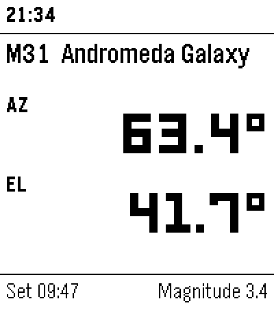
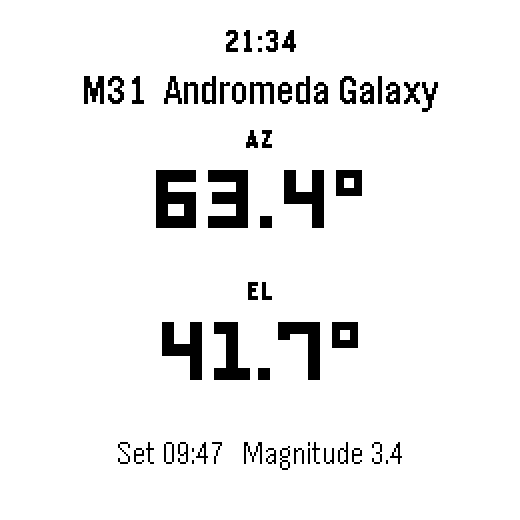
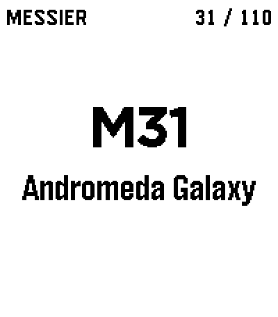
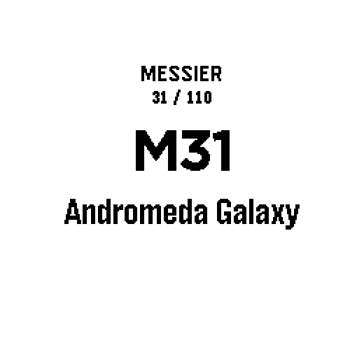

# AstroSlop

AstroSlop is a planned Pebble watchapp for visual astronomy with an
altitude-azimuth mount, such as a Dobsonian telescope. It will show where to
point a telescope using a setting circle and an inclinometer.

**Status:** Design version 0.1 is available for review. The repository currently
contains the Pebble SDK starter app; the astronomy features are not yet
implemented. The images below are emulator mockups, not screenshots of a
finished app.

## Planned features

- Live azimuth and elevation, displayed prominently in degrees to at least
  0.1° and refreshed every second by default. Azimuth is measured clockwise
  from true north.
- On-watch catalogs for the Sun, Moon, planets and selected minor planets; the
  100 brightest stars; all 110 Messier objects; and the 88 IAU constellations.
  Additional catalogs can be added through catalog files and registration.
- Phone GPS at startup and hourly, with manual location as an alternative.
  Astronomy calculations run on the watch, without phone round-trips.
- Configurable object name, local time, next rise or set time, magnitude and
  optional local weather temperature, subject to screen space.
- High-contrast display with an invert option; configurable red backlight on
  Pebble Time 2. Filters can skip objects below a chosen elevation or fainter
  than a chosen magnitude.
- Button navigation: Up/Down change objects, Select changes catalogs,
  long-press Down refreshes location, and long-press Select toggles a timed
  flashlight.

The design targets Pebble Time 2 (**emery**), Pebble 2 Duo (**flint**) and
Pebble Round 2 (**gabbro**). Pebble Time, Time Round and Pebble 2 are planned
on a best-effort basis; aplite is not supported by the design.

## Interface mockups

The main screen emphasizes the pointing coordinates; a temporary banner
identifies an object when the selection changes. Images use the same scale.

| | Pebble Time 2 (emery) | Pebble Round 2 (gabbro) |
|---|---|---|
| Main screen |  |  |
| Object banner |  |  |

More platform and state mockups are in the [design document](docs/DESIGN.md#911-emulator-renderings).

## Theory of operation

The planned watchapp uses the watch clock and a location from the Pebble mobile
app (or manual coordinates). For the selected object, it calculates an
apparent celestial position and converts it to local azimuth and elevation
using sidereal time and the observer's latitude and longitude. Solar-system
positions use planetary, lunar or orbital models; fixed objects use catalog
coordinates corrected for effects such as precession. Elevation includes an
atmospheric refraction correction by default, with optional local weather
temperature. The display also computes the next rise or set event when enabled.

The algorithms are based in part on Jean Meeus, *Astronomical Algorithms*,
2nd edition. See the [astronomy design](docs/DESIGN.md#7-astronomy-algorithms)
for models, assumptions and accuracy targets.

**Solar safety:** Never look at the Sun through a telescope without a properly
installed, purpose-made solar filter.

## Planned data sources

- [NASA/JPL Horizons](https://ssd.jpl.nasa.gov/horizons/) and the
  [Small-Body Database](https://ssd.jpl.nasa.gov/tools/sbdb_lookup.html):
  minor-planet orbital elements and magnitude data.
- IMCCE/Paris Observatory VSOP87 planetary theory, distributed through CDS
  VizieR; lunar and Pluto models as described by Meeus.
- Yale [Bright Star Catalogue](https://heasarc.gsfc.nasa.gov/W3Browse/star-catalog/bsc5p.html)
  via NASA HEASARC, with names from the
  [IAU Catalog of Star Names](https://www.iau.org/public/themes/naming_stars/).
- NASA HEASARC [Messier catalog](https://heasarc.gsfc.nasa.gov/W3Browse/all/messier.html)
  and NGC 2000.0; IAU constellation boundaries digitized in CDS VizieR VI/49.
- The user's weather provider, via the Pebble mobile app's weather plugin,
  when local weather is enabled.

Full source, attribution and licensing details are in the
[design document](docs/DESIGN.md#13-dependencies-data-sources-and-attribution).

## Building the starter app

Install the [Pebble SDK](https://developer.repebble.com/), then run:

```sh
pebble build
pebble install --emulator emery
```

In a headless environment, add `--vnc` to emulator commands. The current
`package.json` still contains the SDK's initial platform list; the final targets
will be configured during implementation.

## Design documentation

Read [Design Document 0.1](docs/DESIGN.md) or its [PDF version](docs/DESIGN.pdf)
for requirements, architecture, algorithms, mockups and verification plans.
