# AstroSlop — Design Document

| | |
|---|---|
| **Status** | Initial Version |
| **Version** | 0.1 |
| **Author** | Sandor Laboratories |
| **License** | Code: MIT. Bundled data: per source (§13). |

---

## Table of Contents

1. [Purpose and Scope](#1-purpose-and-scope)
2. [Requirements](#2-requirements)
3. [Platform Constraints](#3-platform-constraints)
4. [Implementation Decisions](#4-implementation-decisions)
5. [Architecture](#5-architecture)
6. [Behavior and Sequence Diagrams](#6-behavior-and-sequence-diagrams)
7. [Astronomy Algorithms](#7-astronomy-algorithms)
8. [Catalog System](#8-catalog-system)
9. [User Interface](#9-user-interface)
10. [Configuration, Messaging and Persistence](#10-configuration-messaging-and-persistence)
11. [Localization](#11-localization)
12. [Performance, Memory and Power Budgets](#12-performance-memory-and-power-budgets)
13. [Dependencies, Data Sources and Attribution](#13-dependencies-data-sources-and-attribution)
14. [Verification Strategy](#14-verification-strategy)
15. [Future Enhancements and Extension Points](#15-future-enhancements-and-extension-points)
16. [References](#16-references)

---

## 1. Purpose and Scope

AstroSlop is a Pebble watchapp for **visual astronomy in the field with an altitude–azimuth mount**,
such as a Dobsonian telescope. The user selects a catalog object; the watch continuously displays
its **azimuth and elevation** for the observer's location and current time. The user points the
telescope with an azimuth **setting circle** and an **inclinometer**.

The app does one thing: it tells the user where to point. Everything else is secondary.

### 1.1 Glossary

| Term | Meaning |
|---|---|
| Az | Azimuth, measured in this app from **true North (0°) through East (90°)**, range 0–360°. |
| El | Elevation (altitude) above the horizon, −90°…+90°. Refraction is applied by default. |
| RA/Dec | Right ascension / declination (equatorial coordinates). |
| J2000 | Standard epoch/equinox, JD 2451545.0 (TT). |
| JD / JDE | Julian Day (UT) / Julian Ephemeris Day (TT). |
| ΔT | TT − UT (≈ 69 s in 2026). |
| LST/GAST | Local Sidereal Time / Greenwich Apparent Sidereal Time. |
| PKJS | PebbleKit JS: the app's JavaScript component, which runs inside the Pebble mobile app. |
| Settings page | The app's configuration page in the Pebble mobile app: a bundled HTML file declared as `configPage` in `package.json`. |
| Meeus | Jean Meeus, *Astronomical Algorithms*, 2nd ed. (1998). Cited as `[Meeus Ch. N]`. |
| Flashlight | The backlight held on for a fixed time, toggled by long-pressing Select (UX-11). |

---

## 2. Requirements

Requirement status indicates design coverage, not implementation progress: ✅ addressed,
⚠️ limitation noted, 🔮 future.

### 2.1 Platform

| ID | Requirement | Status | Design ref |
|---|---|---|---|
| PLT-1 | Support Pebble Time 2 (**emery**), Pebble 2 Duo (**flint**) and Pebble Round 2 (**gabbro**) | ✅ | §9 |
| PLT-2 | Gabbro may reduce secondary fields, but always shows Az/El | ✅ | §9.4 |
| PLT-3 | Older models are best effort and must not impact the required models | ⚠️ basalt, chalk and diorite supported; aplite not supported | §3.2 |
| PLT-4 | Watchapp written in C | ✅ | §5 |

### 2.2 Astronomy Core

| ID | Requirement | Status | Design ref |
|---|---|---|---|
| AST-1 | All calculations run on the watch, with no phone round-trips | ✅ | §7 |
| AST-2 | Meeus algorithms preferred; references cited in the code and in this document | ✅ | §7, §16 |
| AST-3 | Use hardware acceleration and SDK lookup tables where appropriate | ⚠️ neither is usable: the SDK ABI is soft-float, and the SDK trig lookups are not accurate enough | §3.1 |
| AST-4 | Flag hardware limitations early | ✅ | §3 |
| AST-5 | Algorithm complexity matches the display resolution (≥ 0.1°) | ✅ | §7.9 |
| AST-6 | Astronomy core reusable as a library | ✅ portable C99, no `pebble.h` | §5.3 |
| AST-7 | Support minor-planet positions through 2036 using a precomputed element table; default spacing is 60 days and configurable at build time | ✅ | §7.5 |
| AST-8 | Apply atmospheric refraction by default; use elevation-derived pressure and standard temperature unless an unexpired local weather reading is enabled | ✅ | §7.7 |

### 2.3 Catalogs

| ID | Requirement | Status | Design ref |
|---|---|---|---|
| CAT-1 | Use reliable public data, prefer institutional sources, minimize sources where practical, and use community sources only when institutional data is unavailable; credit all sources | ✅ | §13 |
| CAT-2 | **Sol System**: the Sun first, then the major planets by distance (the Moon takes Earth's place; Pluto counts as major), then the minor planets by distance | ✅ | §8.5 |
| CAT-3 | **Brightest Stars**: the 100 brightest stars, brightest first | ✅ | §8.5 |
| CAT-4 | **Messier**: the 110 objects, in order M1…M110 | ✅ | §8.5 |
| CAT-5 | **IAU Constellations**: the centers of all 88 | ✅ | §8.5 |
| CAT-6 | Catalogs stored on the watch if they fit | ✅ ~15 KB | §8.3 |
| CAT-7 | Extendable: a catalog file plus a registration step | ✅ CSV + one line in `catalogs.json` | §8.2 |
| CAT-8 | Future: imported files, favorites, observation plans, dynamic catalogs | 🔮 extension points defined | §15 |

### 2.4 Display

| ID | Requirement | Status | Design ref |
|---|---|---|---|
| DSP-1 | Az/El in a large, high-contrast font in the center of the screen | ✅ | §9 |
| DSP-2 | Degrees with at least 0.1° resolution; finer resolution optional where it fits and is accurate | ✅ 0.1° or 0.01° | §9.6 |
| DSP-3 | Az/El is always displayed | ✅ | §9 |
| DSP-4 | An error placeholder is shown when the value is unknown | ✅ `---.-°` | §9.7 |
| DSP-5 | Configurable secondary fields: local time, object ID/name, only the next rise or set, magnitude and optional local temperature | ✅ abbreviated or omitted on smaller screens | §9 |
| DSP-6 | Refresh every 1 s by default, configurable to at least 1 min | ✅ 1 s, 5 s, 15 s, 1 min | §10.1 |
| DSP-7 | Measure azimuth clockwise from true North (0°) through East (90°) | ✅ | §1, §7.6 |
| DSP-8 | Format local and rise/set times using the watch's 12/24-hour setting | ✅ | §9.6 |

### 2.5 Location and Time

| ID | Requirement | Status | Design ref |
|---|---|---|---|
| LOC-1 | Observer position from the phone's GPS through standard Pebble mechanisms | ✅ PebbleKit JS geolocation with the `Location` permission | §3.5, §6.4 |
| LOC-2 | Position refreshed at launch and every hour | ✅ | §6.4 |
| LOC-3 | A standard Pebble icon shows when time or position is unknown | ✅ PebbleOS and Rebble icons | §9.7 |
| LOC-4 | Manual location overrides GPS; off by default; defaults to Greenwich; latitude, longitude and elevation are editable, with a "Use last phone GPS fix" control | ✅ | §10.1 |
| LOC-5 | Provide a map/pin picker for manual location if practical | ⚠️ not provided; manual coordinates are available through LOC-4 | §3.5 |
| LOC-6 | Long-press Down forces a GPS refresh | ✅ | §9.9 |
| LOC-7 | Keep using the persisted location fix until a fresh fix arrives | ✅ | §6.5 |
| LOC-8 | When local weather is enabled, honor the plugin's `validUntilMs` or expire the reading after 3 h if absent; resubscribe at each GPS refresh | ✅ | §3.5, §7.7 |
| TIM-1 | Use the watch clock, synchronized by the Pebble mobile app, as observer time | ✅ | §3.4 |

### 2.6 UX

| ID | Requirement | Status | Design ref |
|---|---|---|---|
| UX-1 | Single purpose, no clutter | ✅ | §9 |
| UX-2 | Black on white by default, with an invert option | ✅ | §9.8 |
| UX-3 | Use Pebble system fonts only; display Az/El in the largest practical, readable font | ✅ per-platform LECO font ladder | §9.5 |
| UX-4 | Red backlight by default where supported (configurable) | ⚠️ emery only (white LED on other models) | §3.3 |
| UX-5 | Option to dim the backlight | 🔮 future; no SDK brightness control | §3.3, §15 |
| UX-6 | Down = next object, Up = previous object, Select = next catalog | ✅ | §9.9 |
| UX-7 | On a change of object or catalog, briefly show the catalog title and the selected object's ID and name in large text (can be turned off) | ✅ | §9.3 |
| UX-8 | Filters set on the phone: minimum elevation and faintest magnitude | ✅ | §8.6 |
| UX-9 | Configure the app through the Pebble mobile app's bundled `configPage` (not legacy Clay), with an "Advanced" section | ✅ | §10.1 |
| UX-10 | en_US by default; SDK localization facilities used from the start | ✅ | §11 |
| UX-11 | Long-press Select toggles a configurable timed flashlight (1, 2, 5 or 10 min; default 5 min). Enabled by default on emery, disabled elsewhere. | ✅ white light on non-emery models | §6.8, §9.9 |
| UX-12 | Provide an on-watch About and Credits screen, opened with long-press Up | ✅ | §9.10 |

### 2.7 Non-functional (in priority order)

| ID | Requirement | How it is addressed |
|---|---|---|
| NFR-1 | Stable | Host unit tests for the astronomy core; bounded resource reads; no dynamic allocation in hot paths; versioned persisted structs |
| NFR-2 | Maintainable, extendable and modular | Layered modules with one-way dependencies, catalog providers and data-driven catalogs |
| NFR-3 | Human-readable code | Descriptive names, SDK `prv_`/`s_` conventions and Doxygen headers |
| NFR-4 | Well documented | This document, header documentation, README and CREDITS |
| NFR-5 | Minimal | No background worker, timeline, AppGlance or JavaScript libraries |
| NFR-6 | Use standard Pebble infrastructure | AppMessage, PebbleKit JS geolocation, persistent storage and Light API |
| NFR-7 | Dependencies listed | §13 |
| NFR-8 | Open source | MIT-licensed code; openly published data with attribution |

---

## 3. Platform Constraints

Constraints are based on SDK 4.44 documentation, platform definitions, build flags and emulator
probe builds.

| Platform | Display | Shape | Colors | App RAM (code + heap) | Backlight | Support |
|---|---|---|---|---|---|---|
| **emery** (Pebble Time 2) | 200×228 | rect | 64 | 128 KB | **RGB** (`PBL_RGB_BACKLIGHT`) | Required |
| **flint** (Pebble 2 Duo) | 144×168 | rect | B/W | 64 KB | White LED | Required |
| **gabbro** (Pebble Round 2) | 260×260 | round | 64 | 128 KB | White LED | Required |
| basalt (Pebble Time) | 144×168 | rect | 64 | 64 KB | White LED | Best effort |
| chalk (Pebble Time Round) | 180×180 | round | 64 | 64 KB | White LED | Best effort |
| diorite (Pebble 2) | 144×168 | rect | B/W | 64 KB | White LED | Best effort |
| aplite (Pebble) | 144×168 | rect | B/W | **24 KB** | White LED | **Not supported** |

### 3.1 ⚠️ No hardware floating point (AST-3)

* The SDK compiles every platform with `-mcpu=cortex-m3 -mthumb`, a soft-float ABI, so the FPU on
  flint, emery and gabbro is not used. Forcing FPU flags would depend on undocumented firmware
  behavior, and these FPUs are single-precision only.
* `libm` is linked by default. Double-precision `sin`, `cos`, `tan`, `asin`, `acos`, `atan2`,
  `fmod`, `sqrt` and `floor`, including the soft-float routines, add **about 14 KB** of code.
* The SDK trig lookups were measured on the emulator against double-precision `libm`:

  | Function | Max error |
  |---|---|
  | `sin_lookup` / `cos_lookup` | ≈ 0.0014° |
  | `atan2_lookup` | **0.22°** |
  | Equatorial → horizontal using lookups | **El 0.23°, Az·cos(El) 0.22°** |

  A 0.1° display needs a computational error below 0.05°, so the lookups are not used (D-1). They
  would not save meaningful power either: about 17 µs per tick with `libm`.
* The astronomy core therefore uses double-precision `libm` behind a thin `astro_math` wrapper. The
  caching pipeline (§7.1) keeps the CPU cost negligible, and no work is offloaded to the phone.

### 3.2 ⚠️ Aplite not supported (PLT-3)

Aplite has 24 KB for code and heap. `libm` with soft-float (~14 KB), the astronomy core (~12 KB)
and the UI do not fit, so aplite is not in `targetPlatforms`. Basalt, chalk and diorite have the
same 64 KB as flint and are supported without extra constraints.

### 3.3 ⚠️ Backlight (UX-4, UX-5, UX-11)

* Only **emery** has an RGB backlight (`PBL_RGB_BACKLIGHT`). The other models have white LEDs, so a
  red tint is not possible on them.
* The Light API (`light_enable_interaction`, `light_enable`, `light_set_color_rgb888`,
  `light_set_system_color`) has **no brightness control and cannot suppress the backlight**. On
  white-LED models only the system settings can disable or dim it.
* On emery the tint is **Red** (default) or **System**. The tint code is compiled only for `PBL_RGB_BACKLIGHT`, and the settings
  page shows the tint only for emery.
* The flashlight (§6.8) uses `light_enable()` with an `AppTimer` and works on every platform. On
  non-emery models it is white, which affects dark adaptation, so it is disabled by default there.
  The app always calls `light_enable(false)` when it exits.

### 3.4 Time source (TIM-1)

* The time source is the **watch clock** (`time()`, UTC), which the Pebble mobile app keeps synced
  with the phone.
* A typical clock error of ≤ 1 s is ≤ 0.004° of sky rotation (§7.9).
* A clock earlier than 2025-01-01 is treated as unset: Az/El shows `---.-°` and the Alarm clock icon
  is displayed.

### 3.5 PebbleKit JS, permissions and settings page (LOC-1, LOC-2, LOC-4, LOC-5, UX-9)

* PebbleKit JS (PKJS) runs only while the watchapp is open, and on iOS its timers do not fire while
  the Pebble mobile app is suspended. The **watch therefore drives the hourly location refresh**
  with an `AppTimer` and a request message (D-9).
* `navigator.geolocation.getCurrentPosition` may return the last known phone position when it
  times out.
* **Permissions.** SDK 4.44 builds use manifest version 2, where an app can use only the
  permissions it declares in `package.json`. AstroSlop declares only `Location`:

  ```json
  "usesPermissions": [
    { "name": "Location", "reason": "To compute where objects are in your sky", "required": true }
  ]
  ```

  * Without the `Internet` permission no data can leave the phone, and the Pebble mobile app may
    grant `Location` without an install-time prompt.
  * Until the user answers a permission request, `getCurrentPosition` fails with
    `PERMISSION_DENIED`. The app treats this as temporary and retries (§6.4).
    `Pebble.permissions.query()` distinguishes "prompt" from "denied", and only "denied" is shown
    as "Location denied" on the watch.
  * Emulator testing: `pebble emu-permission Location --deny/--grant/--reset`.
  * **Weather permission.** The SDK protects the `weather/location` source, used by the optional
    "Use local weather" setting (status-bar temperature and refraction, §7.7, §9.2), with the
    `Location` permission. One permission
    entry has a single `required` flag, so the weather option has no separate entry. Instead,
    **turning the option on starts a permission check and request** (§6.6):
    1. PKJS calls `Pebble.permissions.query("Location")`.
    2. If the result is `"granted"`, PKJS subscribes to the weather source.
    3. If it is `"prompt"`, PKJS subscribes anyway, because using the permission is what makes the
       Pebble mobile app request it. While the settings page is open, the request appears in the
       page's title bar, and the page shows "Allow Location in the Pebble app to use local
       weather". Each `PERMISSION_DENIED` result is treated as temporary, and the subscription is
       retried every time the settings page opens and at every location request (§6.4).
    4. If it is `"denied"`, the option is switched back off and the page shows "Location permission
       is off for AstroSlop. Turn it on in the Pebble app to use local weather."

    In every case except a successful read, no temperature is shown and refraction uses 10 °C.
* **Manual location (LOC-4, LOC-5).** A map picker would need map tiles and network access. The
  settings page provides editable coordinates (LOC-4).
* **Settings page (UX-9).** `package.json` declares a bundled HTML page,
  `"configPage": "src/pkjs/config.html"`. The Pebble mobile app shows it in place of the legacy
  `showConfiguration` / `webviewclosed` flow, and the page exchanges messages with PKJS while it is
  open:

  ```js
  // config.html (settings page)
  Pebble.addEventListener("ready", async () => {
    const state = await Pebble.sendMessage("pkjs", { op: "get-state" });
  });
  // index.js (PKJS)
  Pebble.addEventListener("configmessage", e => e.respond({ settings, lastFix, platform }));
  ```

  * The page has no network access, matching the app, so it is a single self-contained HTML file
    with inline CSS and JS. External links use `Pebble.openUrl()`.
  * ⚠️ The mechanism is described in the SDK's *Plugins (Preview)* guide and needs **Pebble mobile
    app 1.18 or later**. It is supported in the emulator (`pebble emu-app-config`).

### 3.6 Fonts (UX-3)

Only the LECO numeric system fonts have monospaced digits together with `.` and `°`, so values do
not shift sideways as they change. Measured widths of `"359.9°"`: LECO 42 is 135 px and LECO 38 Bold
is 124 px. `FONT_KEY_BITHAM_42_BOLD` has proportional digits, and
`FONT_KEY_ROBOTO_BOLD_SUBSET_49` lacks `.` and `°`. The per-platform choice is in §9.5.

### 3.7 Buttons (UX-6, UX-11, LOC-6)

All gestures use the standard `window_single_click_subscribe` and `window_long_click_subscribe`
handlers (long-click delay 700 ms). With a long-click handler registered, the SDK delivers either
the single click or the long click, never both.

### 3.8 Storage and other limits

* Persistent storage is **1 MB per app** on flint, emery and gabbro (4 KB on older platforms).
* App resources can be up to **256 KB**.
* The SDK `snprintf` does not support `%f`, so numbers are formatted with fixed-point integer code
  (§9.6).

---

## 4. Implementation Decisions

Requirements are in §2; this section records implementation choices and rationale.

| ID | Implementation choice | Alternative | Rationale |
|---|---|---|---|
| D-1 | Double-precision `libm` (soft-float) | SDK lookups; fixed point; FPU | SDK lookup errors exceed the 0.1° display budget; about 14 KB is affordable, and caching keeps CPU use low (§3.1, §12). |
| D-2 | Truncated VSOP87D for Sun and planets [Meeus Ch. 32] | JPL approximate elements | JPL elements omit Pluto and have up to 0.17° error; truncated VSOP87D costs about 40 KB (§7.5). |
| D-3 | Meeus Ch. 47 abridged ELP-2000/82 for the Moon, with topocentric parallax | Lower-precision lunar model | About 10″ accuracy; parallax is essential for pointing (§7.5). |
| D-4 | Meeus Ch. 37 for Pluto | Keplerian elements | About 1″ accuracy within 1885–2099 (§7.5). |
| D-5 | Two-body Kepler propagation from JPL Horizons elements for minor planets (AST-7) | One element set per release; phone-supplied positions | A single set drifts by about 0.1° within months; a table supports on-watch computation (§7.5). |
| D-6 | Sæmundsson refraction model (AST-8) | No refraction; standard conditions | Corrects apparent altitude; pressure derives from elevation, with optional weather temperature (§7.7). |
| D-7 | Compile CSV catalogs into one packed binary resource | C arrays; on-watch JSON parsing | Keeps catalog data in resources and avoids loading the pack into RAM (§8.3). |
| D-8 | Catalog provider interface | One hard-coded catalog type | Fixed-star, solar-system and future catalogs share an interface (§5.3, §8.4). |
| D-9 | Watch-driven location refresh (LOC-2) | PKJS `setInterval` | PKJS timers may be suspended on iOS (§3.5). |
| D-10 | PebbleOS and Rebble status icons from `pebble-dev/iconography` (Apache-2.0) | Custom icons | Uses established Pebble ecosystem icons (LOC-3, §9.7). |
| D-11 | LECO with a per-platform font ladder (UX-3) | Other system fonts; bundled font | Monospaced digits stay aligned without adding font resources (§3.6, §9.5). |

---

## 5. Architecture

### 5.1 System context

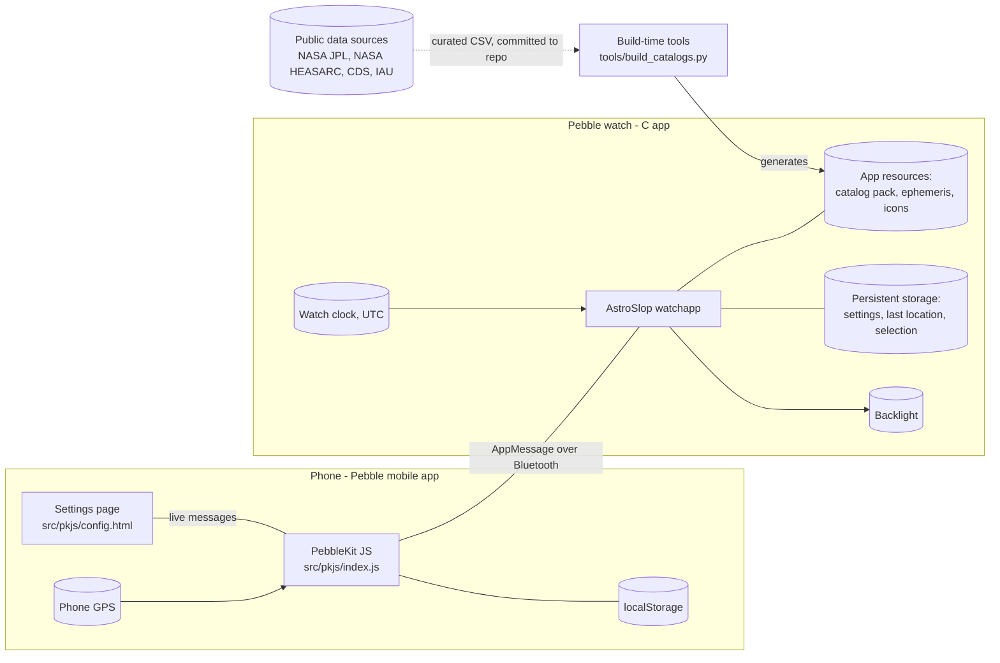

### 5.2 Watch module architecture (layered)

Each layer may use only the layers **below** it. The `astro` library at the bottom depends on
nothing except the C standard library and `<math.h>`. §5.3 describes each module.

```
┌──────────────────────────────────────────────────────────────────────────┐
│ APPLICATION          main.c · app_controller                             │
├──────────────────────────────────────────────────────────────────────────┤
│ PRESENTATION         main_window · banner_layer · about_window           │
│ (Pebble UI)          layout · format · icons · theme                     │
├──────────────────────────────────────────────────────────────────────────┤
│ SERVICES             settings · location · backlight · messaging · l10n  │
│ (Pebble APIs)                                                            │
├──────────────────────────────────────────────────────────────────────────┤
│ DOMAIN               catalog_registry · fixed_catalog                    │
│                      solar_system_catalog · catalog_filter               │
│                      ephemeris · resource_reader                         │
├──────────────────────────────────────────────────────────────────────────┤
│ astro/               time · sidereal · coords · precession · nutation    │
│ (portable C99,       aberration · refraction · vsop87 · sun · moon       │
│  no pebble.h)        pluto · kepler · magnitude · riseset                │
└──────────────────────────────────────────────────────────────────────────┘
        dependencies point downward only (▼)
```

Key dependencies across layers:

| From | Uses |
|---|---|
| `app_controller` | every UI window, `settings`, `location`, `backlight`, `catalog_registry`, `catalog_filter`, `ephemeris` |
| `main_window`, `banner_layer` | `layout`, `format`, `icons`, `theme`, `l10n` |
| `settings`, `location` | `messaging` (AppMessage dispatch) |
| `catalog_registry` | `fixed_catalog`, `solar_system_catalog` → `resource_reader` |
| `fixed_catalog`, `solar_system_catalog`, `ephemeris` | `astro/*` |
| `catalog_filter` | `ephemeris` (cached elevation) |

### 5.3 Module responsibilities

| Module | Responsibility | Key API (sketch) |
|---|---|---|
| `main.c` | Entry point. Runs init in order, then the event loop, then teardown. | `main()` |
| `app/app_controller` | Owns the app state (selected catalog and object, mode). Handles ticks and input actions, and coordinates ephemeris, UI and services. | `controller_init()`, `controller_on_tick()`, `controller_on_action(Action)` |
| `app/app_state.h` | Plain data types for the observable state the UI renders | `AppState`, `PointingSolution` |
| `ui/main_window` | Main Az/El screen. Builds layers from `layout` metrics and renders `AppState`. Its click config provider maps button gestures to controller actions (§9.9). | `main_window_push()`, `main_window_update(const AppState*)` |
| `ui/banner_layer` | Temporary full-screen "object/catalog" card (UX-7) | `banner_show(...)`, `banner_hide()` |
| `ui/about_window` | Scrollable About and Credits (data attributions) | `about_window_push()` |
| `ui/layout` | Per-platform rects, font ladders and visible fields. Isolates all `PBL_IF_ROUND_ELSE` and size logic. | `layout_get(const GRect*)` |
| `ui/format` | Fixed-point formatting of angles, magnitudes and times (no `%f`) | `format_angle(char*, size_t, int32_t centideg, ...)` |
| `ui/icons` | Loads and draws status icons by priority, including the flashlight indicator | `icons_draw_status(GContext*, StatusFlags)` |
| `ui/theme` | Color scheme (normal or inverted) | `theme_apply(const Settings*)` |
| `services/backlight` | Applies the backlight tint (emery). Owns the **flashlight** on/off state and its auto-off `AppTimer`. Turns the light off at deinit. | `backlight_apply(const Settings*)`, `backlight_flashlight_toggle()`, `backlight_flashlight_is_on()` |
| `services/settings` | Settings struct: defaults, load/save (versioned), applying `CFG_*` messages from the settings page | `settings_get()`, `settings_handle_message()` |
| `services/location` | Observer location state machine, refresh timer and retries, persistence of the last fix | `location_get(Observer*)`, `location_request_refresh(bool force)` |
| `services/messaging` | Opens AppMessage and routes inbox tuples to settings or location | `messaging_init()` |
| `services/l10n` | String-table lookup by ID for the active locale (§11) | `_(STR_ID)` |
| `catalog/catalog.h` | **Provider interface** (§8.4) | `CatalogProvider` |
| `catalog/catalog_registry` | Reads the pack directory and exposes the ordered list of catalogs | `registry_count()`, `registry_get(i)` |
| `catalog/fixed_catalog` | Provider for fixed J2000 objects (stars, Messier, constellations) | — |
| `catalog/solar_system_catalog` | Provider for computed bodies (Sun, Moon, VSOP87 planets, Pluto, Kepler bodies) | — |
| `catalog/catalog_filter` | Applies the min-elevation and min-brightness filters while cycling | `filter_find_next(cat, from, dir, ...)` |
| `catalog/resource_reader` | Bounded reads from resources (the pack is never fully loaded into RAM) | `rr_read(handle, off, buf, n)` |
| `ephem/ephemeris` | Two-rate pipeline: caches apparent RA/Dec, computes Az/El every tick, schedules rise/set | `ephem_get_pointing(obj, now, observer, out)` |
| `astro/*` | Reusable astronomy library (§7) | e.g. `astro_equ_to_hor()` |

### 5.4 Source tree (proposed)

```
astroslop/
├── docs/DESIGN.md                    ← this document
├── README.md, LICENSE (MIT), CREDITS.md (all data/asset attributions)
├── REUSE.toml, LICENSES/             ← per-file license mapping and license texts (REUSE)
├── package.json                      ← targetPlatforms (no aplite), usesPermissions, configPage, messageKeys, resources
├── wscript                           ← + pre-build step calling tools/build_catalogs.py
├── catalogs/                         ← human-editable catalog sources (CSV + headers)
│   ├── catalogs.json                 ← REGISTRATION: ordered list of catalogs
│   ├── sol_system.csv
│   ├── brightest_stars.csv
│   ├── messier.csv
│   └── constellations.csv
├── ephemeris/                        ← truncated VSOP87D + Pluto/Moon term tables (generated, committed)
├── tools/
│   ├── build_catalogs.py             ← CSV → resources/catalogs.bin (stdlib only)
│   ├── build_ephemeris.py            ← VSOP87D full files → truncated resources/ephemeris.bin
│   └── fetch/                        ← optional scripts that regenerate CSVs from upstream sources
├── resources/
│   ├── catalogs.bin                  ← generated
│   ├── ephemeris.bin                 ← generated
│   └── icons/                        ← PebbleOS/Rebble icons (PNG, 25 and 18 px; Apache-2.0)
├── src/c/
│   ├── main.c
│   ├── app/      app_controller.[ch], app_state.h
│   ├── ui/       main_window, banner_layer, about_window, layout, format, icons, theme
│   ├── services/ settings, location, messaging, backlight, l10n (+ l10n_en_US.c)
│   ├── catalog/  catalog.h, catalog_registry, fixed_catalog, solar_system_catalog,
│   │             catalog_filter, resource_reader, catalog_format.h (binary layout, shared w/ tool)
│   ├── ephem/    ephemeris.[ch]
│   └── astro/    astro_*.{c,h}           ← portable library, no pebble.h
├── src/pkjs/
│   ├── index.js                      ← location provider, watch messages, `configmessage` handler
│   └── config.html                   ← bundled settings page (`configPage`), self-contained HTML/CSS/JS
└── test/
    ├── astro/                        ← host unit tests (gcc, Makefile) for src/c/astro
    └── tools/                        ← python unittest for build_catalogs.py
```

### 5.5 Coding conventions

* C99 with the SDK's warnings-as-errors (`-Wall -Wextra -Werror`).
* SDK style: `prv_` prefix for file-local (`static`) functions and `s_` for file-local state. Each
  module has a public prefix (`astro_`, `ephem_`, `catalog_`, `location_`, …).
* Every astronomy function has a Doxygen header giving units and the source reference, for example
  `/** ... @ref Meeus Ch. 13, eq. 13.5–13.6 */`.
* Inside `astro/`, angles are radians; inputs and outputs in degrees use `*_deg` names. Longitude
  is **east-positive** throughout. Meeus uses west-positive, and every conversion point documents
  this.
* No heap allocation in `astro/`. The app allocates only at window load.

---

## 6. Behavior and Sequence Diagrams

### 6.1 App startup

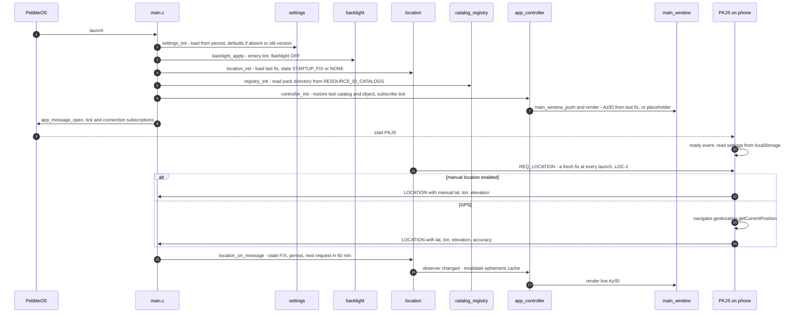

### 6.2 Periodic tick (1 s by default)

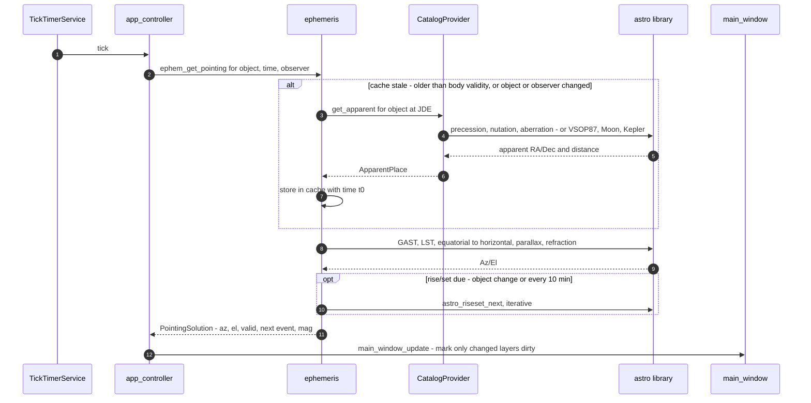

### 6.3 Object and catalog navigation (with filters and banner)

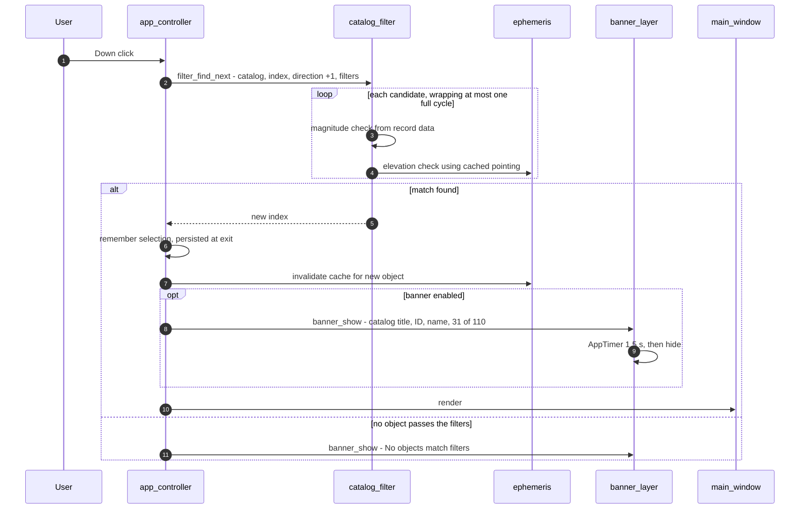

Select (next catalog) and Up (previous object) follow the same flow.

### 6.4 Location refresh

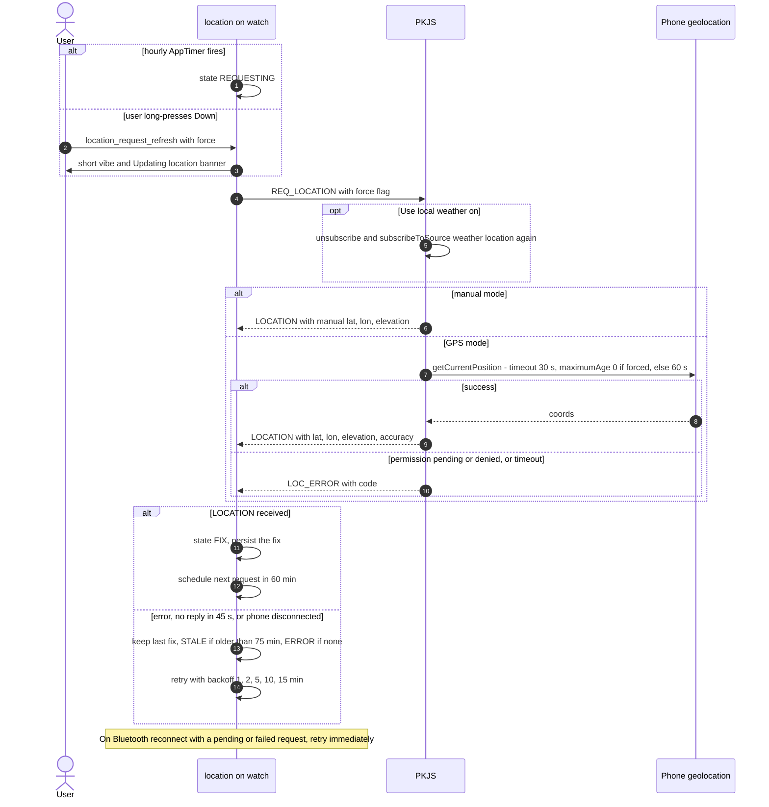

### 6.5 Location state machine

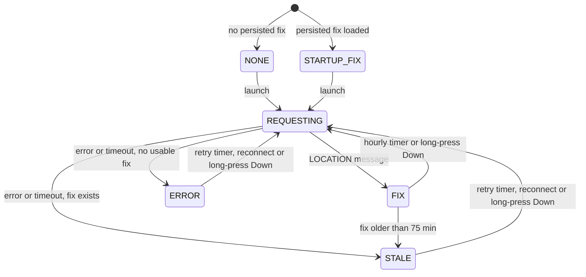

**Persisted fix (LOC-7).** A fresh fix is requested at every launch (LOC-2). Until it arrives, the
last persisted fix is used, so Az/El is shown immediately and the app keeps working when the phone
is out of range. Moving 1 km changes Az/El by at most about 0.01°. A persisted fix is marked with
the Location icon until a fresh fix arrives (icon key in §9.7). If it is older than 12 hours, the Warning icon and
"Old location" are also shown.

| State | Az/El | Status icon |
|---|---|---|
| NONE / ERROR (no usable fix) | `---.-°` | **Location problem** icon. Rect screens also show "No GPS fix" (or "Location denied"). |
| REQUESTING with no fix | `---.-°` | **Location** icon, blinking at 1 Hz when refresh is 1 s |
| STARTUP_FIX / REQUESTING with a fix | live (persisted fix) | Location icon (steady) until the first fresh fix. Persisted fix > 12 h old: **Warning** icon and "Old location". |
| STALE | live | **Warning** icon |
| FIX | live | none |
| Clock invalid (< 2025) | `---.-°` | **Alarm clock** icon |

### 6.6 Configuration change

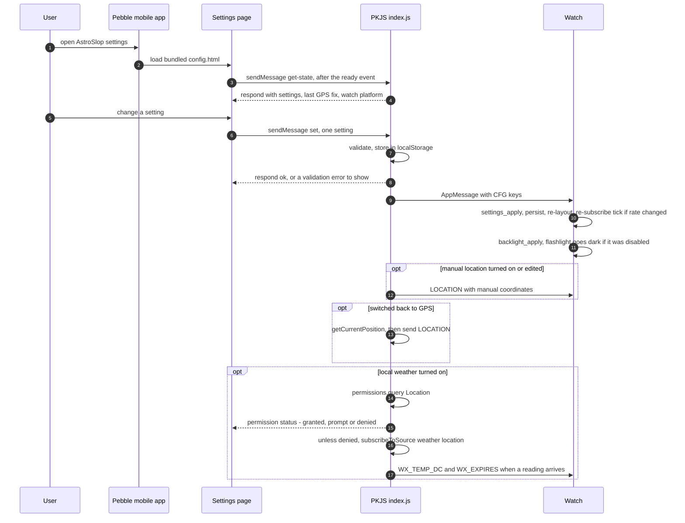

If the `Location` permission is `"prompt"`, subscribing makes the Pebble mobile app ask the user. If
it is `"denied"`, the option is switched back off. Details are in §3.5.

### 6.7 UI modes

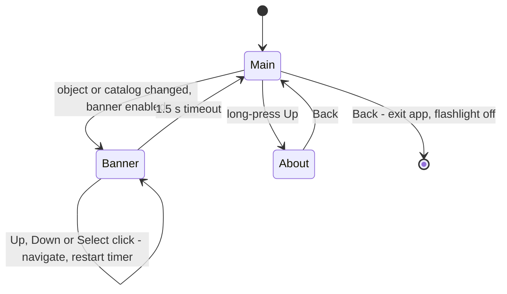

### 6.8 Flashlight (UX-11)

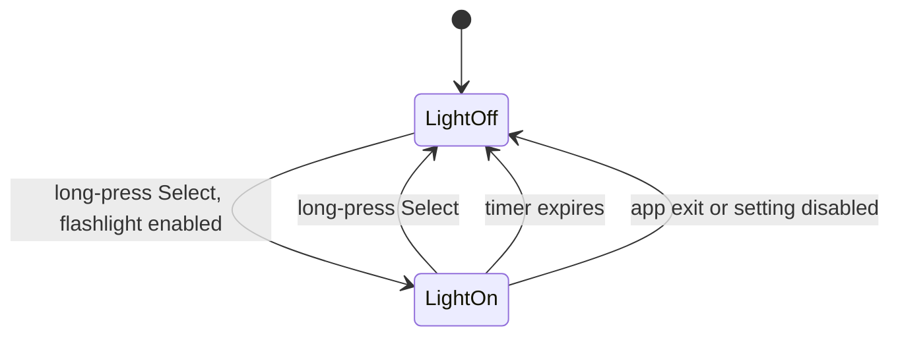

Long-pressing Select while the flashlight setting is disabled does nothing.

* **LightOff → LightOn:** `light_enable(true)`, start an `AppTimer` for the configured duration, short vibe.
* **LightOn → LightOff:** `light_enable(false)` and cancel the timer. A manual toggle also gives a short vibe.
* While the flashlight is on, the flashlight indicator (the PebbleOS Backlight icon, §9.7) is shown
  in the status row.
* Other buttons keep their normal functions while the flashlight is on.
* On emery, the light uses the configured tint.

---

## 7. Astronomy Algorithms

All algorithms are in `src/c/astro/`, use **double** precision, and cite their sources in the code.
Time arguments are **JD(UT)** for Earth rotation and **JDE(TT)** for ephemerides.

### 7.1 Pointing pipeline (two-rate)

The expensive part, the apparent RA/Dec, changes slowly. The cheap part, Earth rotation to Az/El,
changes quickly. The ephemeris module caches the slow result:

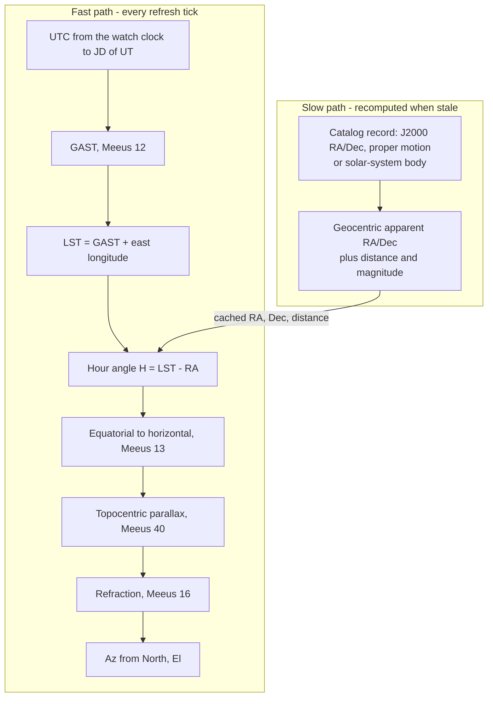

| Body type | Slow-path validity (recompute interval) | Worst-case motion in that interval |
|---|---|---|
| Stars, Messier, constellations | 60 min | < 0.0002° (nutation/aberration drift) |
| Sun, planets, Pluto, minor planets | 60 s | Sun ≈ 0.0007°; fastest planet (Mercury) < 0.0015° |
| Moon | 10 s | ≈ 0.0015° |

The cache is also invalidated whenever the object or the observer changes.

### 7.2 Time [Meeus Ch. 7, 10]

* `JD(UT) = 2440587.5 + unix_seconds / 86400`, using UTC in place of UT1. |DUT1| < 0.9 s, which
  is at most 0.004°.
* `JDE = JD(UT) + ΔT/86400`, where `ΔT = (TAI−UTC) + 32.184 s`. TAI−UTC comes from a leap-second
  table (IERS Bulletin C): 37 s since 2017-01-01, so ΔT = 69.184 s. Outside the table's range the
  Espenak–Meeus polynomial is the fallback.
* `T = (JDE − 2451545.0) / 36525` (Julian centuries). VSOP87 uses millennia, `τ = T/10`.

### 7.3 Sidereal time [Meeus Ch. 12]

* GMST from eq. 12.4 (the IAU 1982 expression in JD(UT)).
* GAST = GMST + Δψ·cos ε (equation of the equinoxes, using nutation from §7.4).
* LST = GAST + λ, with longitude λ east-positive. **Meeus uses west-positive longitude. The
  conversion is done once, in `astro_sidereal_local()`.**

### 7.4 Fixed objects: J2000 → apparent place

For stars, Messier objects and constellation centers:

1. **Proper motion** (linear; stars only): `α += μα*/cos δ · t` and `δ += μδ · t`, with t in years
   since J2000.0. The largest effect in the catalog is about 0.03° (α Cen).
2. **Precession**, rigorous ζ, z, θ [Meeus Ch. 21, eq. 21.2–21.4]. About 0.36° by 2026, so it is
   **mandatory**.
3. **Nutation** in longitude and obliquity (Δψ, Δε), using the low-precision 4-term form
   [Meeus Ch. 22, p. 144], good to about 0.5″. True obliquity ε from eq. 22.2.
4. **Annual aberration** [Meeus Ch. 23, eq. 23.3], using the Sun's true longitude from the
   low-precision formula [Meeus Ch. 25]. Up to 20″.
5. Nutation applied to α and δ [Meeus eq. 23.1].

Annual parallax (< 1″) and light deflection by the Sun are ignored.

### 7.5 Solar-system bodies

| Body | Method | Reference | Expected accuracy |
|---|---|---|---|
| **Sun** | Earth's heliocentric L, B, R from VSOP87D, inverted, then FK5 correction, nutation and aberration (−20.4898″/R) | [Meeus Ch. 25 "higher accuracy", Ch. 32] | ~1″ |
| **Mercury … Neptune** | VSOP87D heliocentric L, B, R for the planet and for Earth → geocentric rectangular, with **light-time iteration**, FK5 correction, nutation and aberration | [Meeus Ch. 32, 33]; Bretagnon & Francou (1988) | ≤ 5″ (truncation target 1″ heliocentric) |
| **Moon** | Abridged ELP-2000/82: Σl, Σr, Σb from tables 47.A/47.B (60 + 60 periodic terms, plus the A1–A3 additive terms and the E eccentricity factor), plus nutation | [Meeus Ch. 47] | ~10″ in longitude, ~4″ in latitude |
| **Pluto** | 43-term periodic series, heliocentric J2000 → geocentric with light-time, then precession to the date | [Meeus Ch. 37] | ~1″. **Valid 1885–2099 only**; outside that range Az/El shows `---.-°`. |
| **Vesta, Juno, Ceres, Pallas** | Two-body Kepler orbit from **JPL Horizons osculating elements** (epoch, a, e, i, Ω, ω, M), taken from a compile-time table with one element set **every 60 days for ~10 years** (2026–2036; the spacing is a build parameter). The set with the nearest epoch is used. Kepler's equation is solved by Newton iteration [Meeus Ch. 30], then J2000 ecliptic → equatorial, light-time, precession and nutation. | [Meeus Ch. 30, 33] | With at most 30 days from the epoch: about 1″–10″ (to be measured against Horizons). After the table ends, accuracy decays (see below). |

**Minor-planet element table.** Osculating elements describe the two-body orbit at one instant;
planetary perturbations (mainly Jupiter) make the real orbit drift from it, reaching about 0.1°
within months. `tools/fetch` therefore takes element sets from JPL Horizons at a fixed spacing, and
`build_ephemeris.py` stores them in `ephemeris.bin` (4 bodies × ~60 epochs × 56 bytes ≈ 13 KB at
the default spacing). The spacing and end date are build-time parameters (`--epoch-step-days`,
default **60**, and `--end-year`, default 2036). They are written to the table header, so the watch
computes the record index from them and needs no code change when they change.
The table stays in resource flash. When a minor planet is selected, only the 56-byte record for
the nearest epoch is read (`resource_load_byte_range`) and held in the ephemeris cache. After the
last epoch the last set is used, and the About screen and the settings page show "Minor planets
accurate until 2036". A new release extends the table.

**Topocentric parallax** [Meeus Ch. 40] is applied in the fast path. It uses the observer's
ρ sin φ′ and ρ cos φ′ (from latitude and elevation, Ch. 11) and the body's distance Δ. It matters
mainly for the **Moon (up to ~1°)**. For the Sun and planets it is below 9″, but it is applied for
consistency.

**VSOP87 truncation.** `tools/build_ephemeris.py` reads the official VSOP87D files (VizieR VI/81)
and drops terms below an amplitude threshold set per series. The goal is ≤ 1″ heliocentric over
1900–2100. The tool reports the resulting term counts and the maximum error compared with the full
series. The estimate is about 1,000–1,500 terms in total, which is about 24–36 KB as `double`
triples (A, B, C) in `resources/ephemeris.bin`. Terms are **streamed** from the resource in small
chunks (for example 32 terms per read) into a stack buffer, so RAM use does not depend on series
length. Meeus Appendix III (an abridged VSOP87D) is the documented reference for the method and for
test values.

### 7.6 Equatorial → horizontal [Meeus Ch. 13]

```
tan A_s = sin H / (cos H · sin φ − tan δ · cos φ)     (A_s from South, Meeus)
sin h   = sin φ · sin δ + cos φ · cos δ · cos H
A_N     = (A_s + 180°) mod 360°                        (azimuth from North, DSP-7)
```

`atan2` resolves the quadrant. At the zenith (|h| > 89.99°) azimuth is undefined. In that case the
display keeps the last azimuth. The affected region is a 0.01° cap.

### 7.7 Atmospheric refraction [Meeus Ch. 16]

The Sæmundsson formula (eq. 16.4) converts true altitude to apparent altitude:
`R[′] = 1.02 / tan(h + 10.3/(h + 5.11))`, with h in degrees, for 1010 hPa and 10 °C. It is scaled
for local conditions by `P/1010 × 283/(273 + T)` [Meeus Ch. 16, p. 107]:

* **Pressure P** is derived from the observer's elevation with the standard-atmosphere barometric
  formula, `P = 1013.25 · (1 − 2.25577·10⁻⁵ · h_m)^5.25588` hPa. At 1500 m this reduces refraction
  by about 16% (≈ 0.09° at the horizon).
* **Temperature T** is 10 °C unless "Use local weather" is on. Then PKJS subscribes to the Plugins
  `weather/location` source (`Pebble.subscribeToSource`), reads `temperature` from the first
  instance, and sends `WX_TEMP_DC` (in °C), `WX_TEMP_UNIT` (the unit the user chose for weather in
  the Pebble mobile app) and `WX_EXPIRES` with every update. The same reading is shown in the status
  bar (§9.2).
  * **Refresh.** The weather plugin decides how often it sends updates (its
    `suggestedRefreshIntervalSec`); the SDK gives the subscriber no interval or force-refresh
    control. PKJS also unsubscribes and subscribes again at every location request (launch, hourly
    and long-press Down, §6.4), which gives the plugin a chance to send newer data.
  * **Expiry.** `WX_EXPIRES` is the update's `validUntilMs` converted to UTC seconds. If the update
    has no `validUntilMs`, PKJS uses the time of receipt plus 3 hours. The watch drops the reading
    once the watch clock passes `WX_EXPIRES`.
  Turning the option on first checks and, if needed, requests the `Location` permission that guards
  the source (§3.5). If the permission is missing or not yet granted, the source is unavailable, a
  read fails, or the reading has expired, refraction uses 10 °C and the status bar shows
  no temperature. The weather source is part of the SDK's
  Plugins (Preview), so it requires plugins to be turned on in the Pebble mobile app.

Refraction is applied only for apparent altitudes above −1°. Below that, the object is not visible
and the uncorrected value is shown. It can be turned off under Advanced (AST-8).

### 7.8 Rise and set [Meeus Ch. 15]

* Standard altitudes h₀: stars and planets **−0.5667°**, Sun **−0.8333°**, Moon
  **0.7275·π − 0.5667°** (π = horizontal parallax).
* Fixed objects use the closed form `cos H₀ = (sin h₀ − sin φ sin δ)/(cos φ cos δ)`. A value > 1
  means the object **never rises**; a value < −1 means it is **circumpolar**.
* Moving bodies use iterative refinement. Estimate the event time from the current RA/Dec, recompute
  RA/Dec at that estimate, and repeat until |Δt| < 30 s (at most 5 iterations; the Moon typically
  needs 3). This is equivalent to Meeus's interpolation method and works with any provider.
* The display shows **only the next event after "now"** (rise or set, whichever comes first; during
  an observing session this is usually the set), within 48 h, in local time (§9.6). It is recomputed when the object changes, when the observer changes,
  every 10 minutes, and right after an event passes.

### 7.9 Accuracy budget vs. display resolution (AST-5)

| Error source | Magnitude | Notes |
|---|---|---|
| Watch clock vs. true UTC | ≤ 1 s typical → ≤ 0.004° | Synced by the Pebble mobile app |
| DUT1 neglected | ≤ 0.9 s → ≤ 0.004° | |
| Star apparent place | < 2″ | |
| Planets (truncated VSOP87) | < 5″ | |
| Moon (Ch. 47) | ~10″ | Parallax corrected |
| Minor planets (two-body, 60-day element table) | ~1″–10″ within the table's range | §7.5 |
| Refraction model vs. real atmosphere | ~0.005° at 10° elevation, a few hundredths of a degree near the horizon | Pressure from elevation; temperature from weather when enabled. Weather-driven pressure changes and horizon anomalies remain. |
| GPS position (±10 m) | negligible (< 0.0001°) | |
| **Total** | **< 0.01° above ~10° elevation** | The 0.1° default display is very safe; 0.01° is meaningful above ~10° |

The display resolution (0.1° default, 0.01° optional) is therefore always no finer than the
computational accuracy, which satisfies AST-5. In practice the mount, the setting circle and
leveling errors (often 0.5–1°) dominate.

### 7.10 Magnitudes

| Body | Method | Reference |
|---|---|---|
| Fixed objects | Catalog V magnitude. Constellations have none, so the magnitude filter lets them pass. | Catalog source |
| Planets | Phase-angle formulas; Saturn includes ring tilt B [Meeus Ch. 45, ring B only] | [Meeus Ch. 41] |
| Moon | `m = −12.73 + 0.026·|ψ| + 4·10⁻⁹·ψ⁴` (ψ = phase angle in degrees) | Allen, *Astrophysical Quantities* |
| Sun | −26.74 | |
| Minor planets | IAU H, G system (H, G from the JPL Small-Body Database) | Bowell et al. (1989); [Meeus eq. 33.14] |

---

## 8. Catalog System

### 8.1 Concepts

* **Catalog**: an ordered list of objects with a title, for example "Messier".
* **Provider**: code that turns a catalog record into an apparent position. There are two now
  (fixed and solar-system) and more can be added later.
* **Catalog pack**: a single binary resource (`RESOURCE_ID_CATALOGS`) that holds all built-in
  catalogs. It is generated at build time from the CSV files.

### 8.2 Adding a catalog (CAT-7)

1. Create `catalogs/my_catalog.csv`. It starts with metadata header lines, followed by the standard
   columns:

   ```csv
   # title: Caldwell
   # short_title: Caldwell
   # provider: fixed
   # source: <citation / URL>
   # license: <SPDX id>
   id,name,ra_deg,dec_deg,pm_ra_mas_yr,pm_dec_mas_yr,mag,type
   C1,,11.0,85.33,,,8.1,open_cluster
   ```

2. **Register** it by adding one line to `catalogs/catalogs.json`. The order of this list is the
   order in which Select cycles through catalogs:

   ```json
   { "catalogs": [
       "sol_system.csv",
       "brightest_stars.csv",
       "messier.csv",
       "constellations.csv",
       "my_catalog.csv"
   ] }
   ```

3. Run `pebble build`. `wscript` calls `tools/build_catalogs.py`, which validates the data (ranges,
   duplicates, encoding, required license and source) and regenerates `resources/catalogs.bin`.
   **No C code changes are needed.** The source and license metadata also feed the About screen and
   `CREDITS.md`.

### 8.3 Binary pack format (version 1, little-endian, packed)

```
PackHeader       { char magic[4] = "ASCP"; uint8 version = 1; uint8 catalog_count; uint16 reserved; }
CatalogDirEntry  { uint32 offset; uint32 length; uint8 provider; uint8 flags; uint16 reserved; }  × catalog_count

Catalog blob (at offset):
  CatalogHeader  { uint16 count; uint16 record_size; uint32 records_off; uint32 strings_off;
                   uint16 title_str; uint16 short_title_str; uint16 credit_str; uint16 reserved; }
  Records        record_size × count
  String table   UTF-8, NUL-terminated; referenced by uint16 offsets

FixedRecord (20 bytes)            — provider = FIXED
  int32  ra_mas          J2000 RA in milliarcseconds  (0 … 1 296 000 000)
  int32  dec_mas         J2000 Dec in milliarcseconds (±324 000 000)
  int16  pm_ra_mas_yr    μα·cosδ (0 if n/a)
  int16  pm_dec_mas_yr   μδ      (0 if n/a)
  int16  mag_cmag        V magnitude × 100; INT16_MIN = unknown
  uint8  type            enum ObjectType (star, galaxy, open/globular cluster, nebula, …, constellation)
  uint8  flags
  uint16 id_str          e.g. "M31", "alf CMa", "And"
  uint16 name_str        e.g. "Andromeda Galaxy", "Sirius", "Andromeda" (0 = none)

BodyRecord (16 bytes)             — provider = SOLAR_SYSTEM
  uint8  kind            SUN | MOON | VSOP87_PLANET | PLUTO | KEPLER
  uint8  index           VSOP87 planet index, or index into Kepler element table
  uint16 id_str, name_str
  … + KeplerElements table in ephemeris.bin: header (first_epoch_jde, step_days, count); per body, count × (epoch_jde, a, e, i, Ω, ω, M); H, G once
```

These structures are defined once, in `src/c/catalog/catalog_format.h`. The Python tool mirrors
them with `struct` format strings, and a unit test checks that the two agree. Estimated sizes:
Messier ≈ 4 KB, stars ≈ 3.5 KB, constellations ≈ 3 KB, Sol ≈ 1 KB, for **≈ 12–15 KB in total**.

### 8.4 Provider interface

```c
typedef struct CatalogProvider {
  uint16_t (*count)(const Catalog *cat);
  bool (*get_info)(const Catalog *cat, uint16_t idx, ObjectInfo *out);       // id, name, type, mag (static)
  bool (*get_apparent)(const Catalog *cat, uint16_t idx, double jde,
                       ApparentPlace *out);                                  // α, δ, Δ (AU, 0 = ∞), mag (dynamic)
  uint16_t slow_path_validity_s;                                             // §7.1 cache policy (per body via flag)
} CatalogProvider;
```

Future providers (user CSV, phone-streamed data, satellites via SGP4) implement the same four
members. The UI, filter and ephemeris modules do not change.

### 8.5 Built-in catalog contents and sources

| Catalog | Contents / order | Fields | Source (§13) |
|---|---|---|---|
| **Sol System** | Sun, Mercury, Venus, **Moon** (in Earth's place), Mars, Jupiter, Saturn, Uranus, Neptune, Pluto, then the minor planets by semi-major axis: **Vesta (2.36 AU), Juno (2.67), Ceres (2.77), Pallas (2.77)** | name; computed position and magnitude | VSOP87 (IMCCE, via CDS), Meeus, NASA/JPL Horizons and SBDB |
| **Brightest Stars** | The 100 brightest stars by apparent V magnitude, excluding the Sun, **sorted brightest to dimmest** (Sirius first). Components the eye cannot separate (closer than 1′, e.g. α Cen A+B, α Cru A+B) are **merged into one entry with the combined magnitude**, at the brighter component's position. | ID = Bayer/Flamsteed in ASCII (`alf CMa`); name = IAU proper name if any; J2000 position, proper motion, V | **Yale Bright Star Catalogue, 5th ed.** (Hoffleit & Warren 1991, Yale University Observatory), from **NASA HEASARC** (table BSC5P, also CDS V/50); names from the **IAU** WGSN |
| **Messier** | M1…M110 | ID `M31`; common name if any; J2000 position; V magnitude; type | **NASA HEASARC** Messier table (from *Sky Catalogue 2000.0*). HEASARC lists 109 objects and omits M102; the usual identification, **M102 = NGC 5866**, is added from the HEASARC NGC 2000.0 table and noted in the CSV. Cross-checked with SIMBAD (CDS). |
| **IAU Constellations** | All 88, alphabetical by Latin name | ID = IAU 3-letter abbreviation; name = Latin name; center | **IAU** official boundaries (Delporte 1930), as digitized by Davenhall & Leggett (1989), CDS VizieR VI/49. The center is the **area centroid on the sphere of the J2000 boundary polygon**, computed by the tool. **Serpens** uses the centroid of **Serpens Caput**, the larger part (ID `Ser`, 88 entries in total). |

Position precision of these sources is ample for the display. BSC5 J2000 positions are given to
0.1 s in RA and 1″ in Dec (≤ 0.0005°). The HEASARC Messier positions are rounded to about 1′
(≈ 0.02°), which is smaller than most of the objects themselves. If finer centers are wanted for
the 0.01° mode, `tools/fetch` can take them from SIMBAD (CDS).

The `tools/fetch/` scripts document exactly how each CSV was derived (queries, filters, merges), so
the data is reproducible and can be refreshed. The generated CSVs are committed, so a normal build
needs no network access.

### 8.6 Filters (UX-8)

* **Minimum elevation** (default **On, 0° = the horizon**, range −10°…+60°) and **minimum
  brightness, i.e. faintest magnitude** (default **Off**, range −2…+15).
* Because the elevation filter is on by default, it is the first item on the settings page, its
  label reads "Skip objects below 0° elevation", and the banner shows
  "Below horizon skipped" the first time an object is skipped in each session.
* Filters apply only **while cycling**. The currently selected object is never hidden or switched
  automatically while the user is looking at it.
* Objects without a magnitude (constellations) always pass the magnitude filter.
* If the location is unknown, the elevation filter cannot be evaluated, so it is ignored and a
  banner says so.
* The search wraps around the catalog at most once. If nothing matches, the app shows a "No objects
  match filters" banner and keeps the current selection.
* Cost: about 2 ms per elevation check for a fixed object. Solar-system bodies use the per-body 60 s
  cache. The worst case is the first Down in Sol System: 14 bodies at about 30 ms each, roughly
  0.4 s, once, on flint.

### 8.7 Selection memory

The last object index for **each** catalog, and the active catalog, are persisted. Select returns to
the object where the user left each catalog.

---

## 9. User Interface

### 9.1 Principles

* Az/El dominates: the largest practical font, centered, **black on white** by default.
* Secondary information is small, sits at the edges, and can be turned off.
* No menus on the watch. All configuration is done on the phone.
* All layout numbers live in `ui/layout.c` and are selected per platform at compile time
  (`PBL_DISPLAY_WIDTH/HEIGHT`, `PBL_ROUND`). Fine-tuning is done from emulator screenshots.

### 9.2 Main screen — Pebble Time 2 (emery, 200×228)

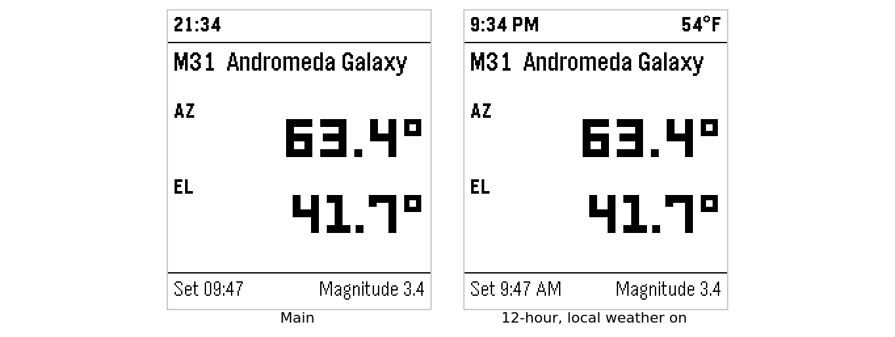

| Region (y, px) | Content | Font |
|---|---|---|
| Status bar (0–24) | Local time (left); temperature and status icons (right) | Gothic 18 Bold; icons 25 px |
| Label (24–56) | Catalog ID and common name, ellipsis if too long | Gothic 24 Bold |
| Az row (56–110) | `AZ` caption at top left; value right-aligned | Gothic 18 Bold; LECO 42 |
| El row (110–164) | `EL` caption at top left; value right-aligned, sign only if negative | Gothic 18 Bold; LECO 42 |
| Footer (200–228) | Next rise or set event (left); magnitude (right) | Gothic 18 |

* The status icons are the flashlight-on indicator (§6.8) and the location status icon (§9.7). They
  appear only when those conditions are active.
* At 0.01° precision, `"359.99°"` measures about 158 px in LECO 42, which still fits within 200 px.
* The local temperature is right-aligned in the status bar, to the left of any icons. It appears only
  when "Use local weather" is on and an unexpired reading is available (§7.7). It is a
  whole number in the user's weather unit (`12°C`, `54°F`).
* The footer shows only the next event, "Rise" or "Set" with its time. It is replaced by
  "Circumpolar" or "Never rises" when that applies.
* The magnitude is labeled "Magnitude" when it fits on the footer line, and "mag" otherwise (§9.6).

### 9.3 Banner

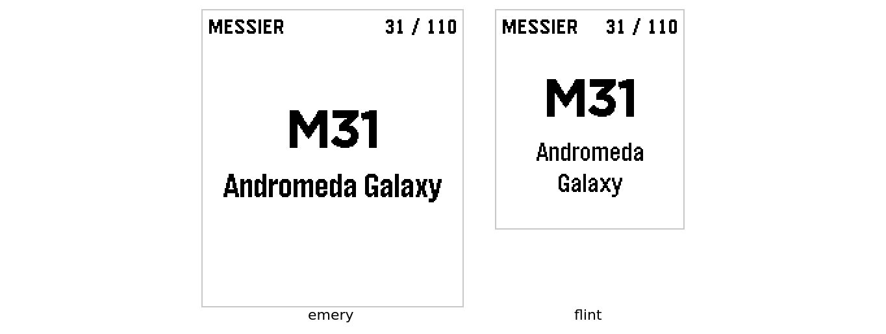

| Line | Content | Font |
|---|---|---|
| Top | Catalog title (left); position in the catalog, e.g. `31 / 110` (right) | Gothic 18 Bold |
| Middle | Catalog ID | Bitham 42 Bold |
| Bottom | Common name, wraps to 2 lines | Gothic 28 Bold (emery), Gothic 24 Bold (flint) |

* The banner is shown for 1.5 s after the object or catalog changes, then dismissed by a timer.
* **Catalog change**: the catalog title is shown large (Gothic 28 Bold), with the first matching
  object's ID and name below it.
* Objects without an ID (planets) show their name at the large size. Long names wrap, and text is
  never cut off without an ellipsis.
* The same banner component shows short confirmations: "Updating location…" (long-press Down),
  "Flashlight on · 5 min" and "Flashlight off".
* The object/catalog banner can be turned off in settings (UX-7). The short confirmations are always
  shown, briefly (1 s), because they acknowledge a hidden gesture.

### 9.4 Main screen — Pebble 2 Duo (flint, 144×168) and Round 2 (gabbro, 260×260)

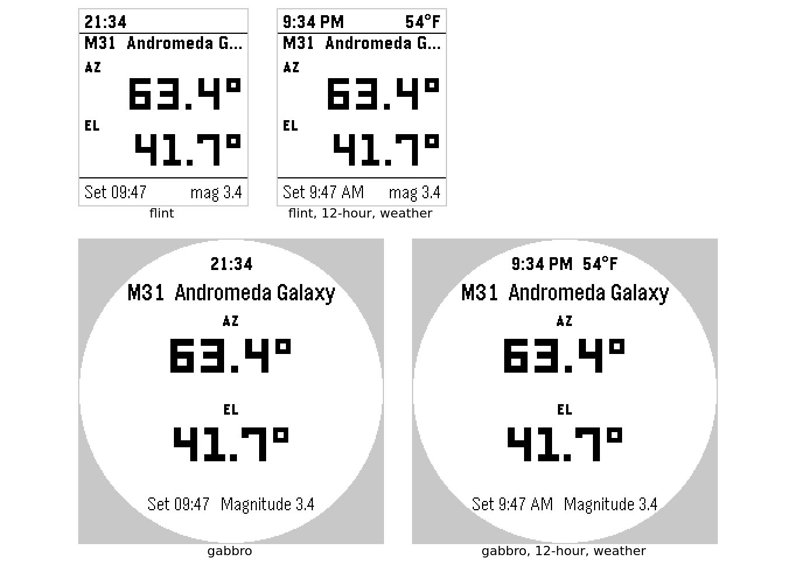

| Region | flint | gabbro |
|---|---|---|
| Status line | Time, temperature, icons (Gothic 18 Bold; icons 18 px) | Time, temperature, one icon, centered (Gothic 18 Bold) |
| Label | ID and name (Gothic 18 Bold) | ID and name, centered (Gothic 24 Bold) |
| Az/El captions | Top left of each row (Gothic 14 Bold) | Centered above each value (Gothic 14 Bold) |
| Az/El values | Right-aligned (LECO 38 Bold) | Centered (LECO 42, as on emery) |
| Footer | Next event; `mag` (Gothic 18) | Next event and `Magnitude`, centered (Gothic 18) |

* **Flint** shows the same information as emery, with the magnitude abbreviated to "mag". The
  temperature fits in the status bar in both time formats. At 0.01° precision the font ladder (§9.5) steps down so the text fits in 144 px.
* **Gabbro** always shows Az/El, centered (the core requirement). Secondary fields follow the curve
  of the screen. The temperature follows the time on the top line (`9:34 PM  54°F`). If space runs
  short, fields are dropped in this order: magnitude, rise/set, temperature, name (the ID stays),
  time. The status icon slot shows the flashlight indicator when no higher-priority
  status icon is showing.
* **Basalt/diorite** use the flint layout. **Chalk** (180×180 round) uses the gabbro layout with
  LECO 38 Bold, no footer and no temperature.

### 9.5 Font ladder (largest that fits)

`layout` picks the first font in the platform's ladder whose rendered width
(`graphics_text_layout_get_content_size`) fits the Az/El row:

| Platform | Ladder (largest → smallest) |
|---|---|
| gabbro | LECO 42 (fits both precisions) |
| emery | LECO 42 → LECO 38 Bold |
| flint / basalt / diorite | LECO 38 Bold → LECO 32 Bold → LECO 28 Light |
| chalk | LECO 38 Bold → LECO 32 Bold |

The ladder is evaluated once, when the layout is built or the precision changes, and never on each
tick. That keeps the digit size stable while values change.

### 9.6 Number formatting

* Angles are converted to integer hundredths of a degree with correct rounding, then formatted
  manually (no `%f`).
* Azimuth `0.0°…359.9°` (360.0 wraps to 0.0), not zero-padded. Elevation `-90.0°…90.0°`, with a
  sign **only when negative** (`41.7°`, `-3.2°`). Both rows share the same right alignment, so the
  decimal points line up.
* Magnitude: one decimal place (`3.4`, `−1.5`). The label is "Magnitude" if the whole footer fits in
  the available width (measured with `graphics_text_layout_get_content_size` when the layout is
  built), otherwise "mag": emery and gabbro show "Magnitude", 144 px screens show "mag". Temperature: whole degrees with unit (`12°C`, `-3°F`).
* Times (local time and rise/set) follow the system 12h/24h setting, `clock_is_24h_style()`, which is
  read at every redraw so a change takes effect immediately:
  * 24-hour: `strftime("%H:%M")` → `21:34`, `09:47`.
  * 12-hour: `strftime("%I:%M %p")` with the leading zero removed → `9:34 PM`. The AM/PM suffix is
    kept on the rise/set time because it can be up to 48 h ahead.

### 9.7 Error and status presentation (DSP-4, LOC-3)

* When the value is unknown, Az/El shows **`---.-°`**. It has the same width as a real value, so the
  layout does not jump.
* The status icon slot shows the highest-priority condition:
  **Location missing/acquiring > Clock invalid > Location stale or old**.
  The flashlight indicator is shown next to it whenever the flashlight is on.
* Icons come from `pebble-dev/iconography` (Apache-2.0): the original PebbleOS system icons, plus
  two Rebble community location icons. They are bundled as PNG at 25 px (emery, gabbro) and 18 px
  (flint, basalt, diorite, chalk).

**Icon key** (shown at 3× size)

| 25 px | 18 px | Meaning | Source icon |
|:---:|:---:|---|---|
|  |  | Acquiring a location, or using the persisted fix until a fresh one arrives (blinks while there is no fix) | `icons/25px_Location` (Rebble) |
|  |  | No usable location: no fix, GPS error or permission denied | `icons/25px_Location_problem` (Rebble) |
|  |  | Watch clock not set | `pebbleos/Pebble_25x25_Alarm_clock` |
|  |  | Location is stale (> 75 min) or the persisted fix is old (> 12 h) | `pebbleos/Pebble_25x25_Generic_warning` |
|  |  | Flashlight on (§6.8) | `pebbleos/Pebble_80x80_Backlight`, scaled down |

* Rect screens show a short reason under the placeholder ("No GPS fix", "Clock not set") in
  Gothic 18. Round screens show the icon only.

### 9.8 Theme and backlight

| Setting | Options | Default | Platforms |
|---|---|---|---|
| Colors | Black on white / White on black | Black on white | all |
| Backlight tint | Red / System default | **Red** | **emery only** (compiled out elsewhere) |
| Flashlight (long-press Select) | Enabled / Disabled | **Enabled on emery; Disabled on all others** | all |
| Flashlight duration | 1 / 2 / 5 / 10 min | **5 min** | all |

On color displays the themes use pure `GColorBlack` and `GColorWhite` for maximum contrast. The
per-platform flashlight default is set in two places: in C (`settings_defaults()`, using
`#if defined(PBL_RGB_BACKLIGHT)`), and on the settings page (from the platform that PKJS reports via
`Pebble.getActiveWatchInfo()`), so the watch and the phone always agree.

**When the flashlight is off, the app does not touch the backlight at all.** The normal PebbleOS
behavior stays in control (a button press or wrist flick lights it for the system timeout, subject to
the user's system backlight settings). On emery only the tint is applied, so those normal backlight
events light up red.

### 9.9 Button mapping (UX-6, UX-11, LOC-6)

| Button | Action |
|---|---|
| **Down** (click) | Next object in the catalog that passes the filters |
| **Up** (click) | Previous object that passes the filters |
| **Select** (click) | Next catalog (wraps) |
| **Select** (long press, ≥ 700 ms) | **Toggle the flashlight** on or off (short vibration; banner). Does nothing if the flashlight is disabled. |
| **Down** (long press, ≥ 700 ms) | **Force a GPS refresh** (short vibration; "Updating location…" banner; the location icon shows while acquiring) |
| **Up** (long press, ≥ 700 ms) | About and Credits screen (§9.10) |
| **Back** | Exit the app (system default; the flashlight turns off), or close About |

### 9.10 About and Credits (watch)

The watch About screen is a Gothic 18 `ScrollLayer`, opened with long-press Up and closed with Back.
It shows the app version, minor-planet validity date (§7.5) and brief credits generated from CSV
source headers (§13.2). Full citations and links appear on the settings page and appstore listing.
A screenshot is in §9.11.

### 9.11 Emulator renderings

SDK-emulator mockups (scale 2) show the §9.2–§9.8 layouts with sample values (M31, Jupiter). The
location icon is a placeholder, and the About text is not scrolled. All images use the same scale;
the top row shows required platforms and the bottom row older supported platforms. Chalk has no
footer or temperature (§9.4); aplite is not supported (§3.2).

**Main**

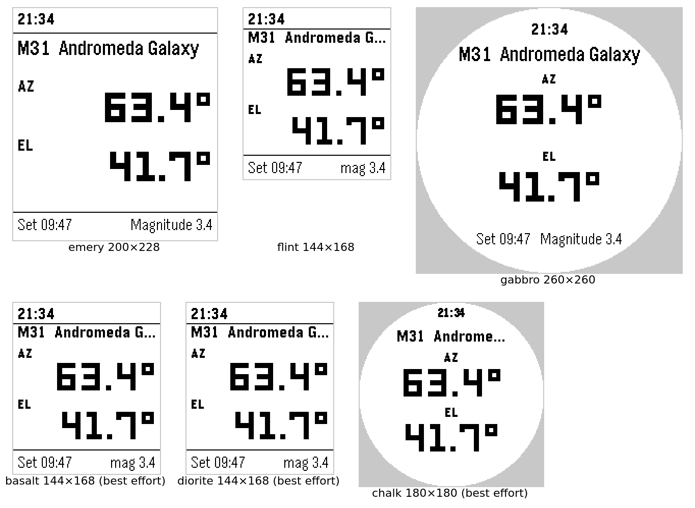

**No GPS fix**

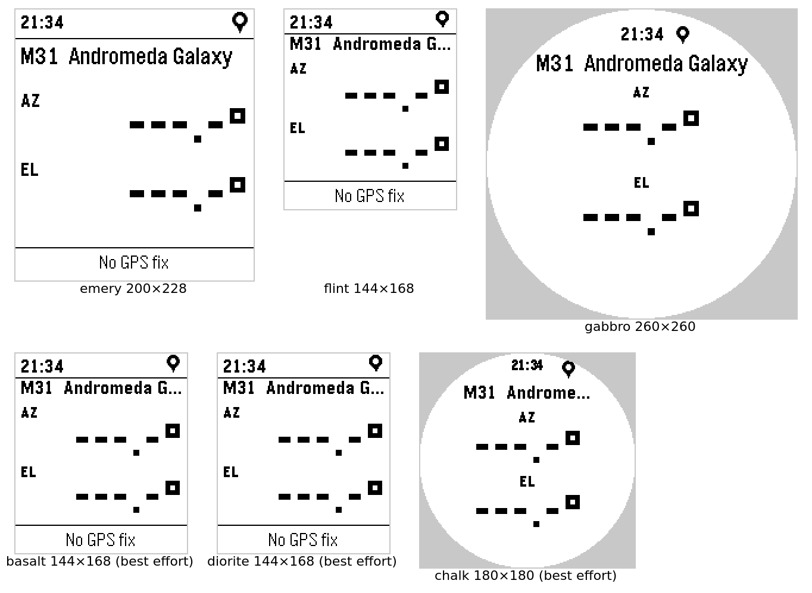

**Banner**

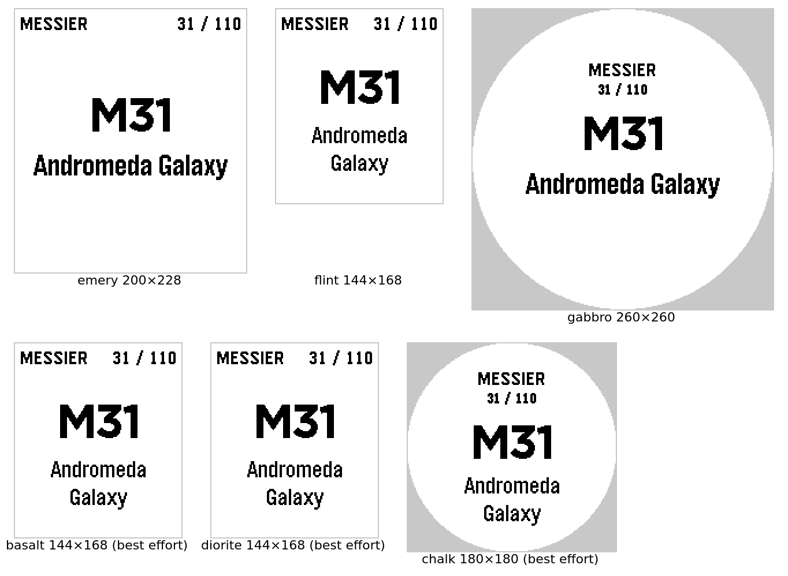

**About**

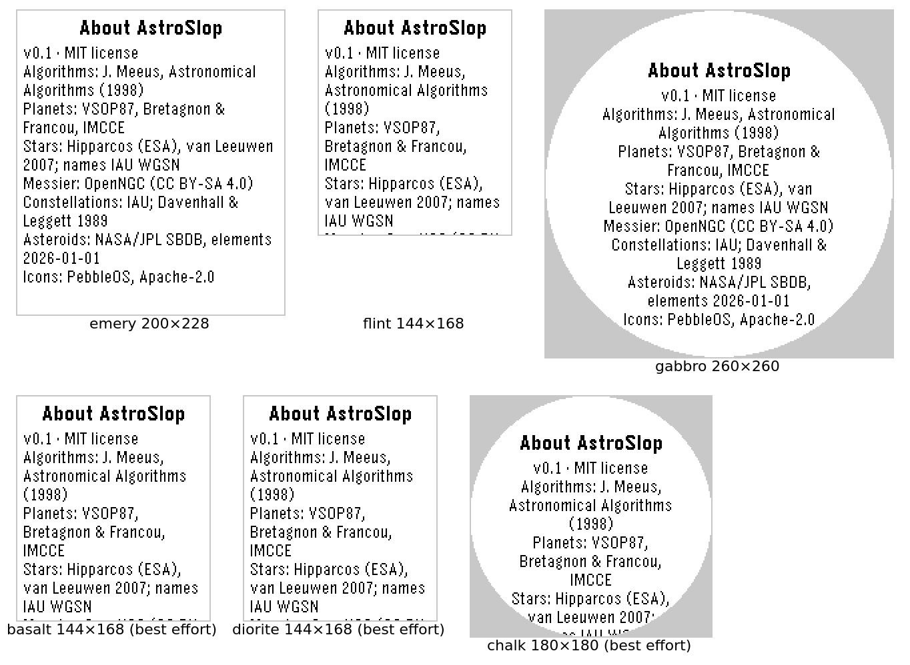

**0.01° mode**

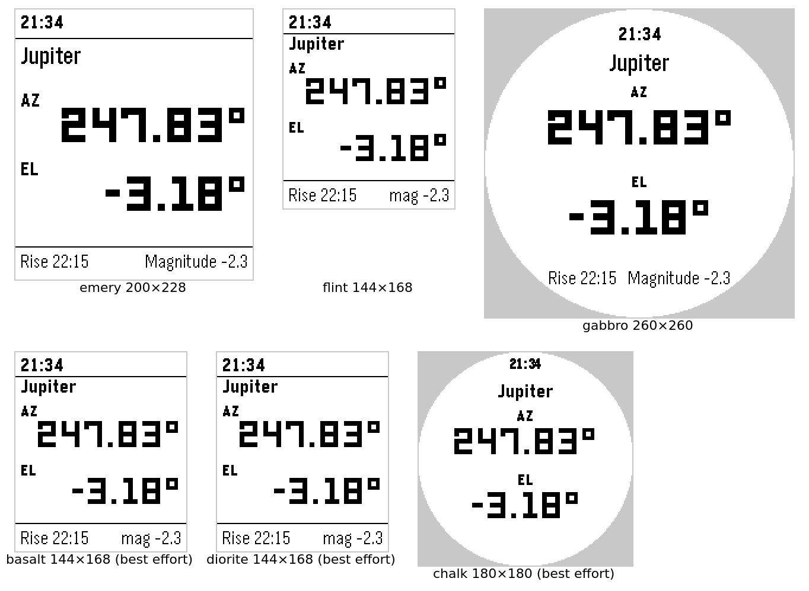

**Inverted**

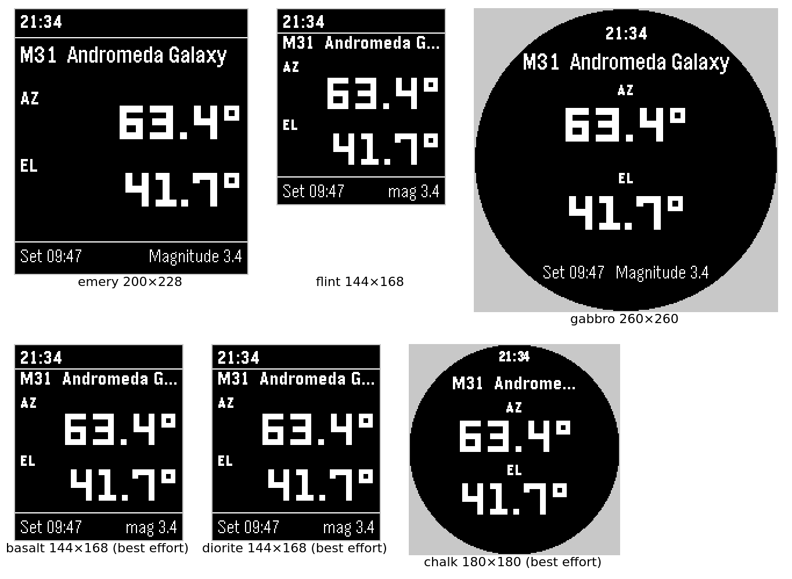

**12-hour clock, local weather on**

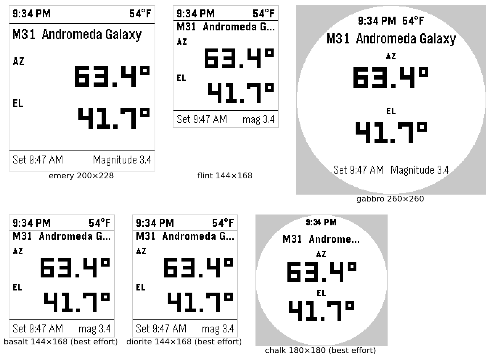

---

## 10. Configuration, Messaging and Persistence

### 10.1 Settings page (`src/pkjs/config.html`, bundled `configPage`)

Settings apply on change: toggles and selects immediately, number fields on valid blur. The page
sends each change to PKJS, which validates and stores it, forwards it to the watch, and returns
validation errors for display. There is no Save button.

| Section | Setting | Type | Default |
|---|---|---|---|
| **Filters** (first section) | Skip objects below elevation | toggle + slider −10…60° | **on, 0° (horizon)** |
| | Faintest magnitude | toggle + slider −2…15 | off (8.0) |
| **Display** | Object label | select: ID / Name / ID + Name | ID + Name |
| | Show local time | toggle | on |
| | Show next rise/set | toggle | on |
| | Show magnitude | toggle | on |
| | Use local weather (temperature in the status bar, also used for refraction) | toggle. Turning it on checks and requests the `Location` permission (§3.5). The page shows the permission status ("Allow Location…" or "Location permission is off…") or "Weather unavailable". | off |
| | Coordinate precision | select: 0.1° / 0.01° | 0.1° |
| | Show name banner when switching | toggle | on |
| | Colors | select: Black on white / White on black | Black on white |
| | Refresh rate | select: 1 s / 5 s / 15 s / 1 min | 1 s |
| **Backlight** | Tint (emery only; hidden on other models) | select: Red / System | Red |
| | Flashlight on long-press Select | toggle (a note on non-emery models: "White light — may affect night vision") | **on (emery) / off (others)** |
| | Flashlight duration (long-press Select again to turn off early) | select: 1 / 2 / 5 / 10 min | 5 min |
| **Location** | Use manual location | toggle | **off** (use GPS) |
| | Latitude (°, +N) | number | **51.4778** |
| | Longitude (°, +E) | number | **−0.0015** |
| | Elevation (m) | number | **46** |
| | "Use last phone GPS fix" | button: asks PKJS for its last fix and fills the three fields | — |
| | (help text) "Long-press Down on the watch to refresh GPS." | text | — |
| **Advanced** | Atmospheric refraction | toggle | on |
| **About** | App version, data sources and licenses (links open with `Pebble.openUrl`) | text | — |

The defaults point at the Royal Observatory Greenwich (Airy Transit Circle). The manual-location
fields are kept in phone `localStorage`. PKJS turns them into a `LOCATION` message, so the watch
never needs to know about manual mode beyond a "manual" source flag.

### 10.2 AppMessage keys (`package.json → messageKeys`)

| Direction | Key | Type | Meaning |
|---|---|---|---|
| watch → phone | `REQ_LOCATION` | uint8 | 1 = normal, 2 = forced (long-press Down) |
| phone → watch | `LOC_LAT_E6`, `LOC_LON_E6` | int32 | Degrees × 10⁶ |
| | `LOC_ALT_M` | int16 | Meters |
| | `LOC_ACC_M` | uint16 | Horizontal accuracy in meters (0 = manual) |
| | `LOC_SOURCE` | uint8 | 0 = GPS, 1 = manual |
| | `LOC_ERROR` | uint8 | 1 = permission not yet granted (retry), 2 = permission denied, 3 = timeout/unavailable |
| | `WX_TEMP_DC` | int16 | Local air temperature in tenths of °C (sent on change while "Use local weather" is on) |
| | `WX_TEMP_UNIT` | uint8 | Display unit: 0 = °C, 1 = °F (the user's weather unit in the Pebble mobile app) |
| | `WX_EXPIRES` | uint32 | UTC seconds after which the reading is dropped: the update's `validUntilMs`, else receipt + 3 h |
| phone → watch (settings page via PKJS) | `CFG_*` | ints | One per watch-relevant setting in §10.1 (including `CFG_FLASHLIGHT_ENABLED`, `CFG_FLASHLIGHT_MIN`) |

The inbox and outbox are sized to the measured maximum dictionary size plus a margin (about 256 and
64 bytes).

### 10.3 Persistent storage (watch)

| Key | Content | Notes |
|---|---|---|
| 1 `SETTINGS` | `Settings` struct with a `version` field | Unknown or old version → migrate or reset to defaults (per-platform flashlight default) |
| 2 `LOCATION` | lat/lon ×10⁶, alt, source, UTC timestamp of the fix | Used at launch (marked stale until refreshed) |
| 3 `SELECTION` | Active catalog index + last index per catalog | Written on change (debounced) and at exit |

The flashlight state is **not** persisted. Every launch starts with the flashlight off.

---

## 11. Localization

* At startup the app calls `setlocale(LC_ALL, "")`, as the SDK i18n guide describes. Only **en_US**
  strings ship. Any other locale falls back to en_US.
* All UI strings use IDs, for example `_(STR_RISE)`, resolved through `services/l10n` from a
  per-locale table (`l10n_en_US.c`). This follows the SDK's Locale Framework pattern without its
  hashing step. Adding a locale means adding one file and one registry line.
* Dates and times use `strftime` and `clock_is_24h_style()`, which the system localizes.
* Numbers always use `.` as the decimal separator because of an SDK limitation. The formatter has a
  hook for a locale-specific separator in the future.
* Catalog object names are data. The pack format reserves room for per-locale string tables (CSV
  columns named `name_<locale>`) in the future.
* Settings page strings are English. The page keeps them in one string table, so it can pick one by
  `navigator.language` later.

---

## 12. Performance, Memory and Power Budgets

These are estimates. They will be measured with `time_ms()` instrumentation in debug builds, on the
emulator and on hardware, and the design is revisited if a budget is exceeded.

### 12.1 CPU (worst case: flint, 64 MHz Cortex-M4, soft-float)

| Operation | ≈ trig calls | Estimated time | Frequency |
|---|---|---|---|
| Fast path (GAST, equ→hor, parallax, refraction) | ~15 | < 1 ms | every tick (1 s) |
| Star apparent place | ~40 | ~2 ms | hourly or on change |
| Planet (Earth + planet VSOP87, light-time ×2) | ~600–800 | 30–40 ms | every 60 s or on change |
| Moon (Ch. 47) | ~150 | ~8 ms | every 10 s |
| Rise/set (moving body, ≤ 5 iterations × 2 events) | ~10 × slow path | ≤ 0.4 s | on change and every 10 min |

Average CPU load stays well below 1%. Long computations either respond to a user action or are
spread out over time. If measurements show rise/set work blocking the UI, it moves to a deferred
`app_timer` step that runs after the banner is drawn.

### 12.2 Memory (flint, the tightest required platform: 64 KB code + heap)

| Item | Estimate |
|---|---|
| libm + soft-float runtime | ~14 KB (measured) |
| astro library | ~12 KB |
| UI, services, catalog, controller | ~14 KB |
| Heap: windows, layers, icons, buffers | ~6 KB |
| **Total** | **~46 KB of 64 KB** (emery/gabbro: 128 KB) |

| Resources | Estimate |
|---|---|
| `catalogs.bin` | ~15 KB |
| `ephemeris.bin` (truncated VSOP87D + Pluto + Moon terms + minor-planet element table ≈ 13 KB) | ~40–55 KB |
| Icons (PNG, 2 sizes × 5) | ~4 KB |
| **Total** | **< 75 KB of 256 KB** |

### 12.3 Power

* Each tick redraws only the layers whose text changed. At a 1 s refresh that is usually just the
  Az/El rows.
* "1 minute" refresh subscribes to `MINUTE_UNIT`. The 5 s and 15 s options use `SECOND_UNIT` and
  skip ticks (the work per skipped tick is a single comparison).
* No background worker. Bluetooth is used about once an hour for location, plus for configuration
  and, when enabled, a message when the local temperature changes.
* Location requests use `maximumAge` of 60 s, except forced (long-press Down) refreshes.
* **The flashlight is the largest single power cost** while it is on. It is bounded by its timer
  (default 5 min, maximum 10 min), always turns off when the app exits, and is never restored at
  launch.

---

## 13. Dependencies, Data Sources and Attribution

### 13.1 Software dependencies

| Dependency | Version | License | Use |
|---|---|---|---|
| Pebble SDK (sdk-core) | 4.44 | Apache-2.0 | Build, APIs, emulator |
| Pebble tool | 5.2.0 | — (tooling, not shipped) | CLI |
| arm-none-eabi GCC + newlib `libm` | bundled with SDK | GPL (compiler, not shipped) / BSD-style (newlib) | Compiler, math |
| Python 3 (stdlib only) | ≥ 3.8 | PSF | Build-time catalog and ephemeris tools |
| Host GCC/Clang | any C99 | — | Host unit tests (not shipped) |

There are no other runtime libraries, on the watch or in PKJS. The settings page is self-contained
HTML/CSS/JS (UX-9).

### 13.2 Data and asset sources (shown in About and in `CREDITS.md`)

Each `tools/fetch` script records the publisher's license or usage statement in the CSV header.

| Data | Institution / source | License / terms acknowledged |
|---|---|---|
| Algorithms | J. Meeus, *Astronomical Algorithms*, 2nd ed., Willmann-Bell, 1998 | Algorithms implemented independently from the book, with chapter citations. No book text is copied. |
| Planetary theory | **IMCCE / Paris Observatory**: VSOP87D, P. Bretagnon & G. Francou (1988), A&A 202, 309; via **CDS** VizieR VI/81 | CDS terms: cite the paper and "CDS/VizieR". |
| Moon | ELP-2000/82 (M. Chapront-Touzé & J. Chapront, **Bureau des longitudes**, 1988, A&A 190, 342), truncated per Meeus Ch. 47 | Cite the theory and Meeus Ch. 47. |
| Pluto | Meeus Ch. 37 series (after Goffin, Meeus & Steyaert) | Cite Meeus Ch. 37. |
| Minor-planet elements, H/G | **NASA/JPL** Solar System Dynamics: Horizons (osculating elements at the table spacing) and the Small-Body Database (H, G) | JPL citation: "NASA/JPL Solar System Dynamics, data retrieved <date>". No NASA/JPL logos or claim of endorsement. |
| Bright stars: positions, proper motions, V | **Yale University Observatory**: Bright Star Catalogue, 5th rev. ed. (D. Hoffleit & W.H. Warren Jr., 1991), from **NASA HEASARC** table BSC5P (also CDS V/50) | No explicit license; cite Hoffleit & Warren (1991) and NASA HEASARC. Used: positions, proper motions and V magnitudes of 100 stars. |
| Star names | **IAU** Working Group on Star Names (WGSN), IAU Catalog of Star Names | Creative Commons Attribution; credit the IAU WGSN. |
| Local temperature (optional) | The user's weather provider, through the Pebble mobile app's weather plugin | Read at runtime only; nothing is stored or redistributed. |
| Messier objects | **NASA HEASARC** Messier table (compiled from *Sky Catalogue 2000.0*, Hirshfeld & Sinnott 1985); M102 = NGC 5866 from the HEASARC NGC 2000.0 table | No explicit license; cite HEASARC and Hirshfeld & Sinnott (1985). Used: positions, types and magnitudes of 110 objects. |
| Constellation boundaries | **IAU**: E. Delporte (1930); digitized by A.C. Davenhall & S.K. Leggett (1989), **CDS** VizieR VI/49 | CDS terms, as for VSOP87. Used: boundary vertices, to compute 88 centers at build time. |
| Cross-checks | SIMBAD, **CDS** Strasbourg (Wenger et al. 2000, A&AS 143, 9) | SIMBAD acknowledgement: "This research has made use of the SIMBAD database, operated at CDS, Strasbourg, France". |
| ΔT / leap seconds | **IERS** Bulletin C; F. Espenak & J. Meeus, **NASA**/TP-2006-214141 | NASA / IERS publications; cite them. |
| Status icons | `pebble-dev/iconography`: PebbleOS system icons and Rebble community icons | **Apache-2.0**. Ship the license text and mark the icons as modified (resized/recolored). |
| Verification | **NASA/JPL** Horizons | Test reference values only; cited in the test data. |

`LICENSES/` holds the full license texts. Each CSV header records its exact source and
license or terms, and the tool refuses to build a catalog that is missing either one.

### 13.3 Licensing model

* **Code: MIT.** All source code (C, JS, Python tools).
* **Data: per source.** Each catalog CSV keeps its own license or terms note, following the
  [REUSE](https://reuse.software/) convention (`REUSE.toml` plus `LICENSES/`). Code and data are
  licensed separately.
* **Attribution.** The credits required by §13.2 appear on the watch About screen (§9.10), the
  settings page, `CREDITS.md` and the Pebble appstore description.
* **Apache-2.0 icons.** Include `LICENSES/Apache-2.0.txt` and a modification notice.

---

## 14. Verification Strategy

| Level | What | How |
|---|---|---|
| **Unit (host)** | `src/c/astro/` | `make -C test/astro` builds the library with host GCC (it has no Pebble dependency). Test vectors are the Meeus worked examples: 7.a (JD), 12.a/12.b (sidereal time), 13.b (alt/az), 15.a (rise/set), 16.a (refraction), 21.b (precession), 22.a (nutation), 23.a (apparent place), 25.a/25.b (Sun), 32.a and 33.a (Venus), 37.a (Pluto), 47.a (Moon), 41 (magnitudes). Tolerances follow each example's stated precision. |
| **Reference (host)** | End-to-end Az/El | About 50 cases of object × time × site (including high latitude and the southern hemisphere) compared with **JPL Horizons** apparent Az/El (refracted, topocentric). Tolerance is 0.01° for stars, planets and the Moon, and 0.1° for minor planets near their epoch. The Horizons outputs are committed with attribution. |
| **Unit (tools)** | `build_catalogs.py` | Python `unittest`: round trip from pack to parse, validation errors, and format parity with `catalog_format.h` |
| **Build** | All targets | `pebble build` with zero warnings for emery, flint, gabbro, basalt, chalk and diorite. The memory reported by the SDK build must stay within budget. |
| **Emulator** | UI and behavior per platform | For each platform: `pebble install --emulator <p> --vnc`. Take screenshots of the main screen (valid values, `---.-°`, each icon state, flashlight indicator), the banner and the About screen. Exercise button flows with `pebble emu-button click <button>`; add `--duration 1000` for long presses (Select = flashlight, Down = GPS refresh, Up = About). Check the logs for errors and timing instrumentation. Review the round screens (gabbro, chalk) and the 144 px screens separately. |
| **Phone integration** | PKJS + settings page | Emulator settings page (`pebble emu-app-config`), live validation messages, the manual-location path, the weather temperature path (the emulator serves sample weather), including turning the option on with `Location` set to granted, prompt (after `--reset`) and denied, the permission paths (`pebble emu-permission Location --deny/--grant/--reset`), GPS timeout, and per-platform flashlight defaults. |
| **Field** | Real sky and hardware | Point at known objects (Moon, a planet, bright stars) and compare with a planetarium app or Horizons. Check the flashlight duration and red tint on emery. |

---

## 15. Future Enhancements and Extension Points

| Enhancement | Extension point already in the design |
|---|---|
| Equatorial and other coordinate displays | `PointingSolution` already carries RA/Dec. Add a display mode in `layout` and settings. |
| Custom catalogs (CSV/JSON import) | A new `user_catalog` provider. PKJS parses the file and sends the records over AppMessage, where they are stored in persistent storage (1 MB on the required watches) in the same `FixedRecord` format. |
| Favorites / hide / observation plans | A "virtual catalog" provider that holds (catalog, index) references and is persisted. |
| Dynamic catalogs / live ephemeris from public APIs | A `remote_catalog` provider. PKJS fetches data (e.g. JPL Horizons/SBDB) and streams apparent positions. Fresh minor-planet elements could come the same way (AST-7). |
| Artificial satellites (TLE) | A `satellite` provider implementing SGP4 in `astro/`, with a fast-path cache validity of about 1 s. |
| Astronomy library spin-out | `src/c/astro/` is already standalone C99 with host tests. It can move to its own repository or a submodule without code changes. |
| More localizations | `l10n_<locale>.c`, the `name_<locale>` CSV columns, and the settings page string table. |
| Larger digits on emery | Optional bundled open-licensed digit font. |
| Backlight dimming (emery) | A low-intensity tint through `light_set_color_rgb888`, added as a third tint option in `backlight`. |
| Touch (emery/gabbro) | Tap or swipe to change object, through the controller's existing actions. |
| More button gestures | Buttons map to abstract controller `Action`s, so remapping or adding gestures (e.g. multi-click) changes only the click config provider. |

---

## 16. References

1. Meeus, J. (1998). *Astronomical Algorithms*, 2nd ed. Willmann-Bell, Richmond VA. ISBN 0-943396-61-1.
   Chapters used: 7, 10, 11, 12, 13, 15, 16, 21, 22, 23, 25, 30, 32, 33, 37, 40, 41, 45, 47; Appendix III.
2. Bretagnon, P.; Francou, G. (1988). "Planetary theories in rectangular and spherical variables. VSOP87 solutions."
   *Astronomy & Astrophysics* 202, 309–315. Data: CDS VizieR catalog VI/81.
3. Chapront-Touzé, M.; Chapront, J. (1983). "The lunar ephemeris ELP 2000." *A&A* 124, 50–62;
   and (1991) *Lunar Tables and Programs from 4000 B.C. to A.D. 8000*, Willmann-Bell.
4. Standish, E.M. "Keplerian Elements for Approximate Positions of the Major Planets." JPL SSD,
   https://ssd.jpl.nasa.gov/planets/approx_pos.html (alternative considered in D-2).
5. Hoffleit, D.; Warren, W.H. Jr. (1991). *The Bright Star Catalogue*, 5th Revised Ed. (Preliminary Version).
   Yale University Observatory. NASA HEASARC table BSC5P, https://heasarc.gsfc.nasa.gov/W3Browse/star-catalog/bsc5p.html; CDS VizieR V/50.
6. NASA HEASARC. Messier Nebulae and Star Clusters table (MESSIER), https://heasarc.gsfc.nasa.gov/W3Browse/all/messier.html;
   and NGC 2000.0 table (NGC2000) for M102 = NGC 5866. Sources: Hirshfeld, A.; Sinnott, R.W. (1985),
   *Sky Catalogue 2000.0*, Vol. 2, Sky Publishing/Cambridge University Press; Sinnott, R.W. (1988), *NGC 2000.0*.
7. IAU Working Group on Star Names. *IAU Catalog of Star Names*. https://www.iau.org/public/themes/naming_stars/
8. International Astronomical Union. *The Constellations* (official names, abbreviations and boundaries).
   https://www.iau.org/public/themes/constellations/
9. Davenhall, A.C.; Leggett, S.K. (1989). "A Catalogue of Constellation Boundary Data." CDS VizieR VI/49;
   Delporte, E. (1930). *Délimitation scientifique des constellations*. Cambridge University Press.
10. NASA/JPL Small-Body Database. https://ssd.jpl.nasa.gov/tools/sbdb_lookup.html
11. NASA/JPL Horizons System. https://ssd.jpl.nasa.gov/horizons/
12. Espenak, F.; Meeus, J. (2006). *Five Millennium Canon of Solar Eclipses*, NASA/TP-2006-214141 (ΔT polynomials).
13. IERS Bulletin C (leap seconds). https://www.iers.org/
14. Sæmundsson, T. (1986). "Atmospheric refraction." *Sky & Telescope* 72, 70.
15. Bowell, E. et al. (1989). "Application of photometric models to asteroids." In *Asteroids II*, 524–556.
16. Allen, C.W. (1973). *Astrophysical Quantities*, 3rd ed. Athlone Press (lunar magnitude).
17. Wenger, M. et al. (2000). "The SIMBAD astronomical database." *A&AS* 143, 9.
18. Pebble Developer Documentation (SDK 4.44). https://developer.repebble.com — guides used: Hardware
    Information; Backlight; Plugins (Preview), "Settings pages" (`configPage`,
    https://developer.repebble.com/guides/plugins/preview); App Configuration; PebbleKit JS;
    Persistent Storage; Internationalization; System Fonts; Round App UI; Conserving Battery Life;
    Building for Every Pebble; Buttons.
19. PebbleOS source and resources. https://github.com/coredevices/PebbleOS (Apache-2.0).
20. Iconography for Pebble (PebbleOS and Rebble community icons). https://github.com/pebble-dev/iconography
    (Apache-2.0).
